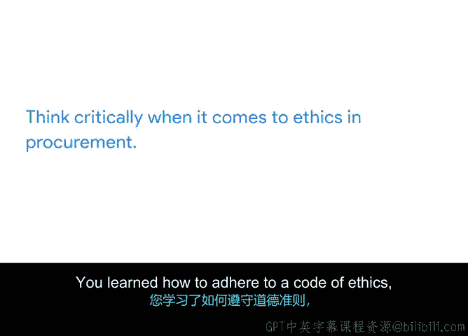

# 谷歌项目管理：专业证书 第3课：《项目规划：将一切整合起来》｜project-planning-google｜ - P31：31_03_01_总结_3.zh_en - GPT中英字幕课程资源 - BV1Y94y1r7gw

Wow， we really covered a lot here。 We learned all about managing costs and budget。

We learned that a project budget is the estimated monetary resources needed to achieve outline goals and objectives。

We learned that a project budget is much more nuanced than just aiming to save money。

 It's a success metric that's used to track project performance。 And remember。

 it's not desirable to be over budget or under budget。

 We also learned that cost control involves several stakeholders sign off from key stakeholders and actively managing changes。

 And we definitely went in depth from procurement and vendor management。

 which involves obtaining the necessary supplies materials and external resources for your project's success。

😊，We learn the important steps initiating， selecting， contract writing， control and completing。

We now know that procurement will be different， depending on which methodology you're using。

 an agile procurement approach differs from a traditional procurement approach。

It's more relationship based because the negotiation stays open the whole time。

An agile procurement requires more frequent communication with vendors because the contracts may be reviewed and adjusted regularly。

The traditional approach is typically done during the procurement stage， and ends there。

We learned about NDAs， RFPs and SOWs， and we created an SOW together。Finally。

 you learned a bit about how to think critically when it comes to ethics and procurement。

You learned how to adhere to a code of ethics， when to use your own judgment and the importance of researching the ethics of procurement。

Nice job。Next up， you're going to learn about different types of risks。

 how to identify risk and how to mitigate risk。 See you there。

