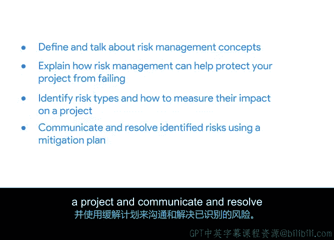

# 谷歌项目管理：专业证书 第3课：《项目规划：将一切整合起来》｜project-planning-google｜ - P32：32_04_01_引言：有效管理风险.zh_en - GPT中英字幕课程资源 - BV1Y94y1r7gw

🎼Welcome back Earl we covered managing costs and a project budget。

🎼We discussed what the components of a project budget are， how the budget process works。

 and how to track and estimate a budget。You also learned about the procurement process。🎼Coming up。

 we will discuss risk management and why it's important to help prevent project failure。

🎼Knowing how to anticipate and alleviate， commonly known as Migate。

 the potential problems is your best bet for keeping a project on track。

🎼You will learn how to define and relate risk management concepts and explain how risk management can help protect your project from failing。

🎼You'll also identify risk types and how to measure their impact on a project and communicate and resolve identified risks using a mitigation plan。

🎼Ready to get started， great， maybe in the next video。

