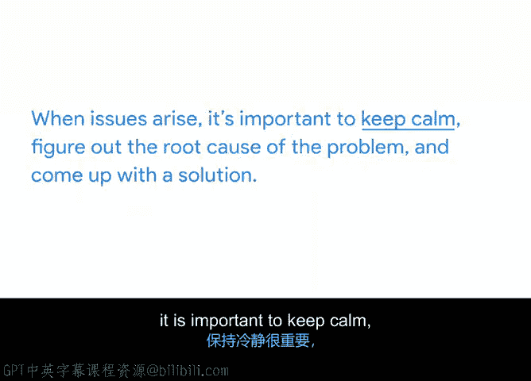

# 谷歌项目管理：专业证书 第3课：《项目规划：将一切整合起来》｜project-planning-google｜ - P33：33_04_02_风险管理的重要性.zh_en - GPT中英字幕课程资源 - BV1Y94y1r7gw

Think about a time in your life when you manage a project。Maybe it was a professional project。

 like creating an employee schedule or a personal project like planning a family celebration。Now。

 ask yourself this。 did everything go according to plan？If I had to guess。

 I would bet there was at least one hurdle you had to deal with。

That's because no project goes 100% according to plan。

 even when they are run by the most experienced project managers。

Maybe you planned that employee schedule perfectly。

 and then someone caught a cold forcing you to rearrange the schedule at the last minute。

Or maybe just as family members started arriving for that celebration。

 you realized you forgot to buy ice to keep the drinks cold。 And hey， these things happen。

 As we told you earlier， flexibility is an important skill for managing projects。

Due to the nature of the project and really life in general。

 it's also important that you identify and plan for risks that could impact your project。

Let's discuss what a risk actually is。A risk is a potential event which can occur and can impact your project。

When you think about risk in the context of project management。

You'll think about them as hypothetical。In other words。

 these aren't events that will definitely happen， but because there's a possibility that they could happen。

 it's your responsibility as the project manager to identify and plan for those risks。Next。

 let's discuss issues。An issue is a known or real problem that can affect the ability to complete a task。

So what's the difference between a risk and an issue？Think of it like this。

 A risk is an event that could potentially happen。 if the event actually happens。

 then the risk becomes an issue。In other words， risks are the big what ifs and issues are things that currently impact a project。

It is clear that risks and issues compose pose a threat to your project。

 how you manage those risks is known as risk management。

Risk management is the process of identifying and evaluating potential risks and issues that could impact a project。

It's not a one time exercise， it's something that you'll need to do regularly to address potential risks。

Risk management is a crucial part of the planning process。

By giving you an understanding of what could go wrong with your project。

It also tells you who you need to consult about the risk。

It helps you determine how the potential risk could be mitigated this way。

 if or when something goes wrong， you'll have a plan prepared and ready to go。

 Part of being proactive and planning ahead is identifying potential risks and how to solve for them。

This way， you'll set up your project with better chances for success。

Failing to engage in meaningful risk management can have a few big consequences for your project。

 First， if you don't plan ahead， you may put your project at risk of not meeting its project goal。

 its timelines or its success criteria。For example。

 if your goal is to publish a research report and your research analyst quits halfway through the project。

 youll likely miss the deadline if you don't have a backup plan ready to go。Additionally。

 by failing to plan for risks， you also fail to think through the many different ways that your project could pivot and still meet its goals。

 even if an issue does arise， there often isn't just one way to meet your project goals and success can come in many forms。

 Ri management helps you determine how flexible or rigid your plan is and then make necessary adjustments。

For example。If your project requires a large product shipment。

 having a backup supplier ready means you could quickly pivot if our main supplier is unable to  fulfill your order finally。

Risks can affect projects in a variety of ways that are difficult to foresee。For example。

 a supplier you've hired may not have adequate stock to cover your purchasing needs。

 or the budget for your project could be cut unexpectedly。

The risk management process helps reduce the impact of unexpected events。

 freeing up resources to focus on activities that benefit the project。

Let's imagine risk management in the context of plant powders at office screen。

 which is a new service that will provide customers with small， low maintenance desk plants。

 One potential project risk is the possibility that the web page for it。

 the new service won't be live in time for the launch。

Another potential risk could be a fulfillment shortage。

What would you do if the plant supplier runs low on the cacti ferns that you need？

To prepare for these potential risks， you will need to think about ways to mitigate these issues before they happen or how you will address these issues if they actually occur。

Hopefully these things won't be a problem， but if they are， you'll be prepared。

I also want to stress the issues will come up throughout the project you did not or could not have planned for。

And that's okay。 When these moments arise， it is important to keep calm。

 Figure out the root cause of the problem and come up with a solution。

Risk management is a really important topic for project managers to understand。

Identifying risks and issues prepares you for the unknown。

It also positively impacts you as the project manager because you'll feel more prepared。

 less stressed， and more confident in your approach if an issue does occur。Up next。

 we will discuss ways that you can identify risks， I'll meet you there。

