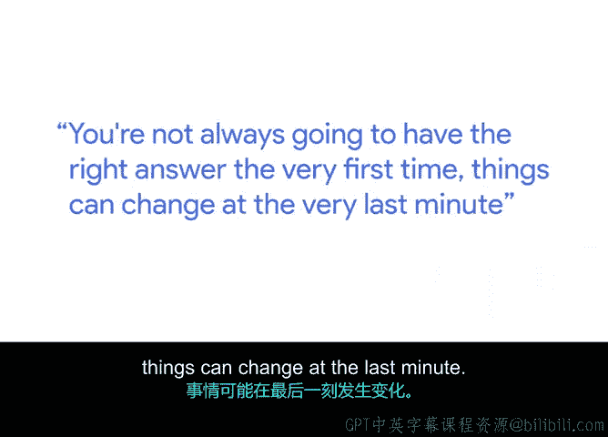

# 谷歌项目管理：专业证书 第3课：《项目规划：将一切整合起来》｜project-planning-google｜ - P34：34_04_03_斯坦顿：管理我的第一个项目.zh_en - GPT中英字幕课程资源 - BV1Y94y1r7gw

Hi， I'm Stanton and I'm a program manager at YouTube。

 thinking back to one of the first projects Iah worked on。

 we're actually in charge of building this sports highlight app。But it wasn't just an app。

 it was an iOS app， it was an Android app， it was a website。

 and I remember the very first meeting I went to， I was just fiercely taking down notes and trying to understand what the heck was going on and immediately after I thought okay。

 this is my first project， I have to get all the details right。

I have to make sure we know every little thing that was going to happen。

The launch date needed to be perfect， we had to get all the bugs down to zero。

 I was just totally consumed with getting everything right the first time。

I think what I've realized since then is you're probably not going to get your first project plan correct because there's just so many things that can change you might find a bug last minute before launch your client might come in and say they want a different requirement like the screen needs to be blue instead of red and then you find out that it's not really that easy to change from blue to red if I could go back and tell myself what to do at that point or what。

What I could have done differently， I would have just told myself。Don't worry so much。

 changes happen， it's how you react and respond to those changes that's more important。

I think one of the best compliments I've gotten is。You know， even throughout all this mess。

 you're cool， you're calm and you're collected， you think through what are the issues that。

Have happened， how do we resolve them？You know， you do your program management thing。

 you're not always going to have the right answer the very first time things can change at the last minute。

If you're able to stay cool and calm， make sure you understand everything else that's going on on the project。

 all these years have taught me that you can always reuse some things。

 you're always going to have to react to some things， but no matter what。

 try to think proactively try to figure out what those issues are going to be and you'll be the better for it。

