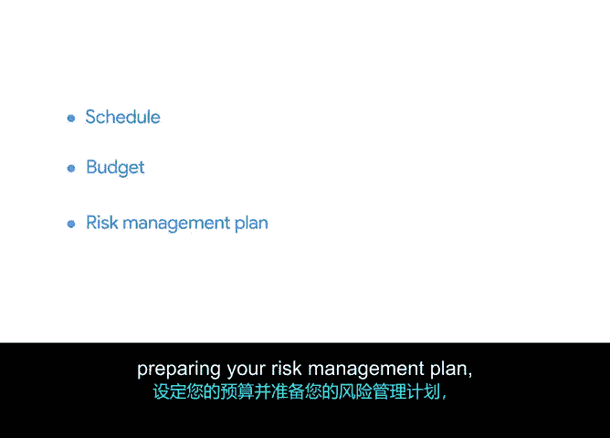

# 谷歌项目管理：专业证书 第3课：《项目规划：将一切整合起来》｜project-planning-google｜ - P3：03_01_02_启动规划阶段.zh_en - GPT中英字幕课程资源 - BV1Y94y1r7gw

Hello again。In the last video， we discussed the importance of planning。 Now。

 let's get into the details of how to launch the planning phase。 As you learned earlier。

 the planning phase is the second phase of a project's life cycle。

 This can be a challenging time for a project manager because there's so much to consider。

But it's important to know that project plans don't have to be perfect the very first time。

 and even if you do a great job with your plans the first time around。

 it's likely that the plan will change as the project evolves The planning phase may differ from project to project。

But generally， three big things are worked out during this stage。 The schedule。

 the budget and the risk management plan。We'll discuss each of these in greater detail。

 later on in the course。But for now， here's some general information so you can understand why these three elements are so crucial to planning。

Let's start with the schedule， the schedule is basically a timeline of the project。

 it includes the start date， the end date and the dates for things that will happen in between。

You'll use time estimation techniques to determine these dates。

 Let's imagine scheduling in our example project at office screen。 As a reminder。

 you're the lead project manager for Project plant Pows。

 a new service that will provide top clients with desk friendly plants。

You want to launch the service by the end of the year。

 So the planning phase for this effort should include a number of key dates。

 Those dates might include when you'll request proposals from plant vendors。

They might also include the date you'll kick off with the web designers and developers who are creating a new website for the service。

 it should also include important dates during the project execution phase。

 like when the plants need to be ready for delivery or when the new webp page design needs to be approved。

And you'll need to include the target date for the launch of the service。

 Another part of the planning phase is setting the budget。

The budget will account for the total cost to complete the project。

The total cost needs to be broken down to determine how much has to be spent on different elements of the project。

For project plant pals， the budget will need to include items like the cost of designing and launching a web page。

 the cost of hiring your plant vendor and much more。

 The third component of the planning phase is risk management。

 which means searching for possible problems and planning ahead to mitigate these risks。

 Let's face it。 riskk is inevitable in every project。

 What's not inevitable is how the risk impacts your project。

Good project planning means searching for places where trouble might occur。

Where might the schedule get off track？Where might the budgets exceed your estimates。

 You'll work with your team to consider answers to these questions and prepare a risk management plan based on whatever you discover。

 Let's go back to the office screen example。While putting together the initial schedule。

 you may realize that your estimates from your developers put you way beyond your launch date to manage that risk。

 you might try to reduce or adjust the project scope to still meet your deadline or even negotiate a new launch date with your stakeholders。

 These are two simple examples of how you might mitigate a scheduling risk。 So to recap。

 you'll spend the planning phase， building your schedule。

 setting your budget and preparing your risk management plan。 But first。

 you need to get the whole team on board。

Next， we'll discuss the project kickickoff meeting。Which is where the project really gets going。

Meet you there。