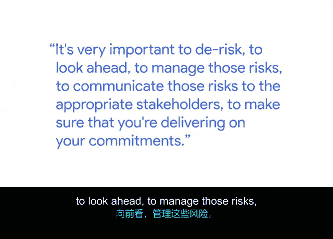
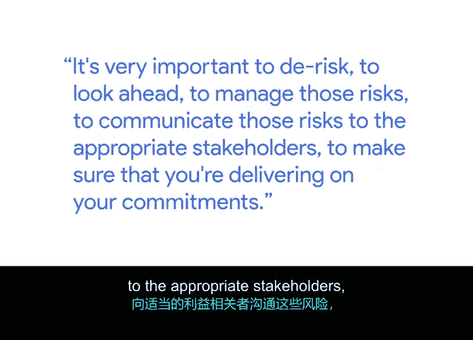
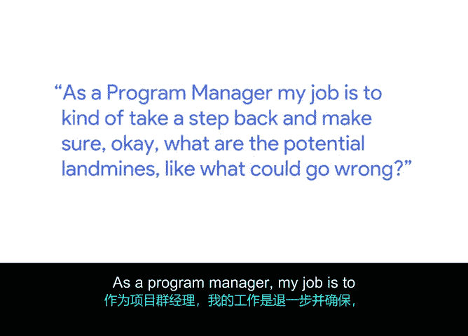
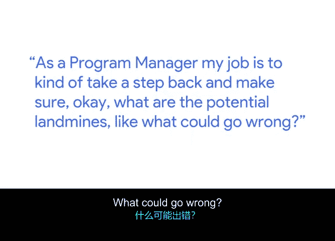

# 谷歌项目管理：专业证书 第3课：《项目规划：将一切整合起来》｜project-planning-google｜ - P40：40_04_01_阿吉：谷歌的风险管理.zh_en - GPT中英字幕课程资源 - BV1Y94y1r7gw

My name is Aji， and I'm a senior program manager at Google。

 Program management spans a lot of different industries， a lot of different applications。At its core。

 it means that we bring order to chaos。 So I Google for me。I work on product launches。

 I also develop new processes and procedures for teams。

 So I work across different functional areas so that could be engineering。 could be U X。

 It could even be people ops。To help launch products to me。

 risk management means looking ahead and trying to anticipate issues。

 So I liken it to the analogy of you know， being on a ship and being the person looking ahead to make sure there's no rocks。

 right， A lot of our projects， I would say， for the most part， at least in my experience。

 are never just done in a silo。 like there are other dependencies。

 right in other teams that are depending on you to， to execute。

 Those's are very important to to de risk， to look ahead， to manage those risks。

 to communicate those risks to， to the appropriate stakeholders。

To make sure that you're delivering on your commitments。

I think that that's the first step is identifying the problems。

 bringing in the right people so that you know that you have a good kind of comprehensive list。

And then from there。M tryinging to figure out how to manage those issues。 And again， that can be。

 And that should be a very collaborative thing right。

 because everybody on your team needs to be equally vested in making sure that the project executes successfully。

 So I have a project right now that I'm， I'm working on。

 and with this project after we determined what our strategy was going to be in what our end state was going to be from a product strategy perspective。

The next step was creating what we call U X Mos or U X designs。 And so basically。

 that's just image pictures of what we want our end state to be。 Like， what's our ideal state。

 right in a visual format As a program manager， My job is to kind of take a step back and make sure。

 O， what are the potential landmins， like what could go wrong。

As I started going through the designs。And looking at them， I realized that in my mind。

 it was hard for me to kind of reconcile and say， okay， this is what we're doing today。

 This is what's going to change。 It wasn't very clear to me。

 And I'm less of a visual person and more of like you know， I like spreadsheets and all of that。

 And have， you know， things in detail。And so in my mind， I was like， okay。

 if I'm having this issue trying to reconcile between， okay， you know， visually。

 we say we're going to design this， but。This is where we are。 like。

 what's the difference If I'm having this issue， then maybe other people are having this issue as well。

And， O， if other people are having this issue， maybe our engineers are having this issue as well。

 And so， you know， when I set up the meeting within five minutes。

 we started to realize that there were differences in how they were interpreting what we were supposed to do。

 The we had gone down this road where。These two teams were executing on things。In different way。

 we wouldn't have realized it into the end。 And then it would have been too late。

 I love program management。 I love coming into a problem。

 being given a problem that's very ambiguous and not well thought through， right？

 And it's a huge pain point。 And then coming up with a solution to that problem。

