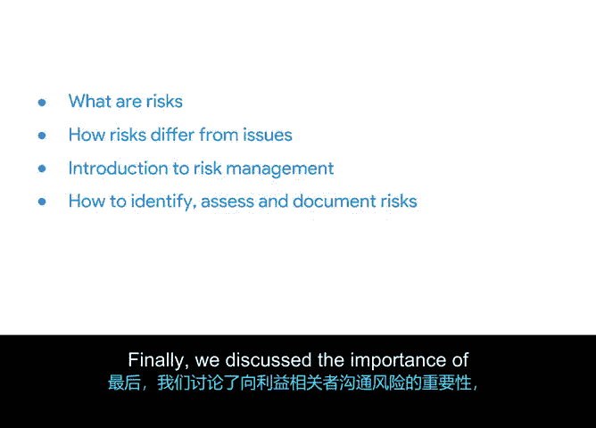

# 谷歌项目管理：专业证书 第3课：《项目规划：将一切整合起来》｜project-planning-google｜ - P41：41_04_02_总结.zh_en - GPT中英字幕课程资源 - BV1Y94y1r7gw

Nice work。 Let's recap what we've discussed so far。You learned about risks。

 which are potential events that could impact your project。

You also learned how risks differ from issues， which are known and real problems that may affect the ability to complete a certain task。

And I introduced you to risk management。Which is the process of identifying potential risks and issues that could impact a project。

And evaluating and applying steps to address their effects。

We've discussed brainstorming as a technique for identifying risks。

 and I introduce you to tools you can use to identify。

 assess and document risks like a probability and impact matrix， a risk register。

 and a risk management plan。And finally， we discuss the importance of communicating risks to your stakeholders。

In order to set expectations and demonstrate your work to plan for and mitigate potential problems with the project。

Coming up， we'll discuss documentation and communication。 See you soon。

