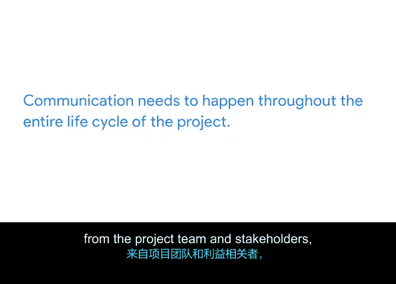

# 谷歌项目管理：专业证书 第3课：《项目规划：将一切整合起来》｜project-planning-google｜ - P43：43_05_02_沟通为何至关重要.zh_en - GPT中英字幕课程资源 - BV1Y94y1r7gw

Okay， let's start with an example。Imagine you've planned a surprise party for your best friend's birthday。

You've been working on it for a month， and finally， it's the big day。

You show up at the restaurant where the party is happening。But there's an issue。

 The host says the reservation was cancelled because no one confirmed。

A friend shows up with the birthday cakeeg， but you'd ask them to bring cupcakes。

Another friend text you saying they're looking forward to seeing everyone tomorrow night， tomorrow。😊。

And then in the middle of all the confusion， you look over to see that your pest's friend has already been seated on the other side of the restaurant。

Not exactly the surprise party you had in mind。What happened。Poor communication happened。

The friend who made the reservation forgot to tell you to confirm 24 hours in advance。

The friend who ordered the cake never saw your email asking him to get cupcakes。

 and you assumed everyone in the group text message got the update that the party was on Friday。

 not Saturday。Fortunately， your best friend appreciated the effort and was surprised anyway。

But whilst you and your best friend can have a good laugh about the party planning breakdown。

 if something like this happens at work， your boss and co workers might not think the same。

Communication is very important to every project。 I'd even argue that it's the most important tool in making sure your project runs smoothly。

Many times， what contributes to the success or failure of a project team comes down to whether or not everyone understands what's happening and how their tasks contribute to the project's goals。

As project manager， you play a big part in making sure everyone knows what their roles and tasks are。

You're also the person that team members come to when they're just in need of a quick answer。

 so being able to communicate clearly and effectively is key。

It's important to remember that without effective communication。

 the project is at risk of missing important opportunities or even failing altogether。

During a project I recently worked on， my stakeholders allocated a few design specialists to work with me。

In the first week of the project， I noticed that one specialist wasn't attending any of the project meetings。

 I decided to approach the individual about their absence。When asked。

 they stated that they were well over capacity with the current workload and were unable to commit to the short deadlines I had been assigning。

There were a couple of breakdowns in communication here first。

 between the specialist and their manager。And second， between the specialist and me。

 the project manager。Ideally， the specialist and their manager would have communicated better with each other about the specialist's ability to take on the workload。

 If I had not communicated with the specialist， their continued absence at meetings could have resulted in lots of lost time。

 The project being delayed or not being able to deliver the project in a satisfactory way。

As it turned out， we only ended up losing a week of work due to the lack of communication。However。

 since I followed up quickly， we were able to pivot and assign another specialist to the project。

So we know communication is very important。😡，But what is communication exactly？To put it simply。

 communication is the flow of information。 It includes everything that's shared。

 how it's shared and with whom good， effective communication is always clear， honest。

 relevant and frequent。😊，But not too frequent。There is such a thing as information overload。

Effective communication makes it possible for your project to run on time and up to the expectations outlined in the project plan。

😊，So take full advantage of tools like meetings， emails， phone calls。

 written documents and formal presentations and make sure they are accessible by everyone。

It's also important to remember that communication is not a one time event or a one way route。

 It needs to happen throughout the entire life cycle of the project。

From the project team and stakeholders as well as from you。

So be sure to clarify goals and client expectations， follow up on action items。

 and communicate delays as the project progresses。😊，This will help you avoid issues and setbacks。

As the project manager， you're responsible for creating a consistent flow of communication throughout the project。

Setting the tone for team communication and working to make sure everyone's on the same page。

 every step of the way gives your project the best chance to succeed。Okay。

 hopefully it's clear that communication is incredibly important to manage a project。😊，Coming up。

 I'll show you how to make a communication plan that will help you manage all important communication。

😊，See you in a bit。