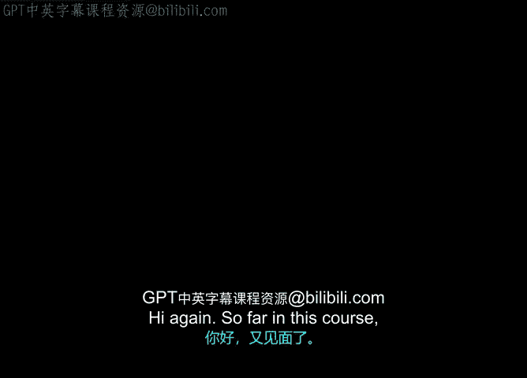
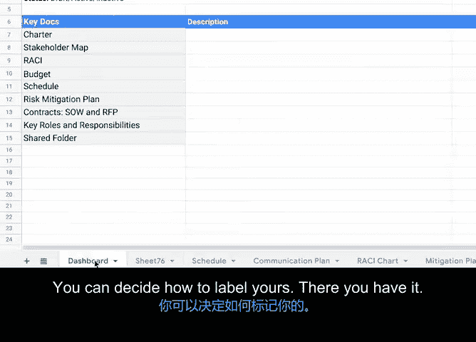

# 谷歌项目管理：专业证书 第3课：《项目规划：将一切整合起来》｜project-planning-google｜ - P47：47_05_02_组织项目文档.zh_en - GPT中英字幕课程资源 - BV1Y94y1r7gw

Hi again， so far in this course， you've filled in or created some different project planning resources like the project plan budget。

RacC chart， risk management plan and now a communications plan。

We also discussed the importance of organizing your communications and having easy and appropriate access to project plans Now I'll show you one way you can organize all your project information in one centralized place。

You'll be able to apply these same general techniques to almost any type of project management style or system。

Organizing your project plans makes everyone's job easier and eliminates opportunity for confusion。

As a project manager， your goal is to have all of your project resources documented and linked in a way to where you or anyone on the project can access what they need quickly。

A couple of handy ways to get organized are using a shared file drive like Google Drive and creating one resource like a document or spreadsheet that links all of the files and resources that your project uses。

Here's an example of how to organizeise your files in Google Drive。

But it doesn't matter which shared system your project team uses。

 You can use the same process for pretty much all of them。 First。

 create a new folder and label it with the name of your project。

Use this folder to store all your project files。You can even create subfolds and store them in the main project folder。

You can also stay organized by creating a centralized planning document that links everything together。

 This can serve as a quick reference guide that you can use to find all your frequently accessed files in one place。

 Here's an office screen example that's already been started。 One at a time。 select a resource name。

 Then link it。😊，Now you can access the file directly from the centralized document。

If your project uses multiple spreadsheets and you want to avoid having to open lots of separate files。

 you can group them within one sheet like this。This sheet has tabs for all the other sheets that contain project information。

You can add a new sheet， at any time。It's helpful to include an overview sheet and link any non spreadsheet files。

 This is also a good place to provide a brief description of the project。

 instructions for how to use the sheet or communication expectations。In this example。

 the overview sheet is called the dashboard。Which is the same thing。

 You can decide how to label yours。

There you have it。 Now you're organized and ready to show everyone what an awesome project manager you are。

😊。