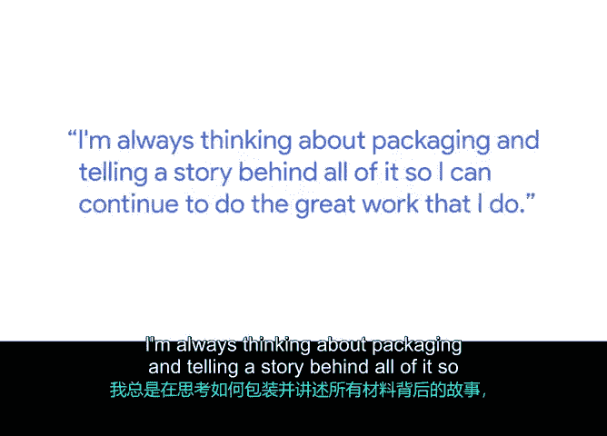
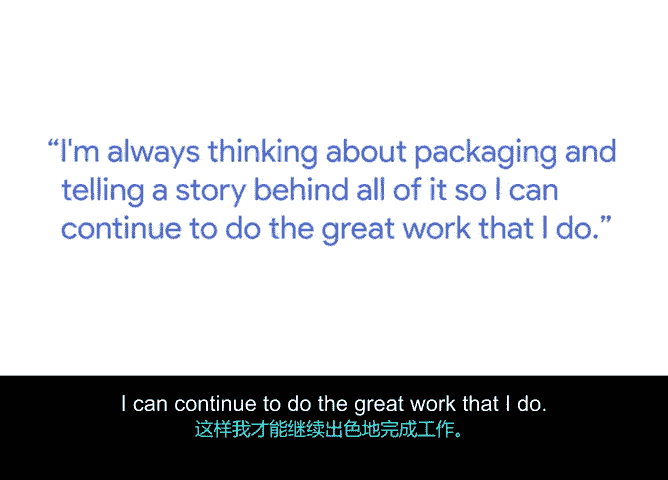
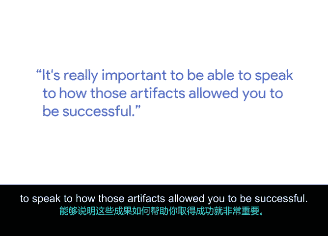

# 谷歌项目管理：专业证书 第3课：《项目规划：将一切整合起来》｜project-planning-google｜ - P48：48_05_03_克里斯：为求职面试整理项目成果.zh_en - GPT中英字幕课程资源 - BV1Y94y1r7gw

Hi， I'm Chris。 I'm a diversity program manager here at Google。 So I lead diversity。

 programming and strategy for one of our business units here at Google。

 I focus in on diversity programming for our most under represented Googlers。

 like our black plus our Latinx and our native populations here at Google manager world where every single day I'm thinking about who needs to be involved in the projects that I work on。

Who will care to invest in the programs that I want to roll out， right。

 because I need to get buy in for certain programs to to get greenlit， right。

 So I'm always thinking about how I'm organizing my materials。

 I'm always thinking about packaging and telling a story behind all of it so I can continue to do the great work that I do。

An artifact is anything that you physically put together that describes or showcases the work that you're doing。

 so that could be a document that is say an executive brief or just an overview of the work that you're doing or it could be something as tactical a roles andresponsibilities sheet so breaking down who on your team is handling what and to whom you need to present it's really important to keep that organized because it's not just for my own use。

 but it's also for anyone who I engage right so a stakeholder or someone who needs to sign off on a project or it might be my teammates on something。

 I often bring in either volunteers or fulltime help to help build the programs that I run Lastly。

 you know say we have an outside vendor， they need to understand where they fit into the larger picture but also。

what they tactically need to do to make the program successful so keeping artifacts allows you to have the best possible outcome in all program management elements and regardless of that piece。

 you also want to be able to showcase your work at the end so that when it comes time to possibly get more budget for a program or to take the programs to the next level you have a good baseline to really understand from where you started and and how far you've come when you have all those artifacts and it's really important to be able to speak to how those artifacts allowed you to be successful。

The artifacts are really what tangibly show someone during a job interview that you were the one that did the work to make the program or a project successful。

 right， So if you just talk about a project or a program at a high level in a job interview。

 the interviewer might。Want to know more detail。 And the artifacts allow you to show that detail。

 allow you to show not only what happened with the project and how far it came。

 but also your contributions to it。 And it physically shows your ability to。

Conduct the entire process from start to finish。 You're the quarterback， right。

 And the quarterback also holds the playbook。 And if you don't have the playbook。

 who on the team is going to know what to do other than you， you run， you run the show。

 And so effectively， you want to make sure that you're able to showcase in any setting。

 whether it be while you're currently working on the project or later during an interview。

 all that you did to make the program or project successful。😊。

