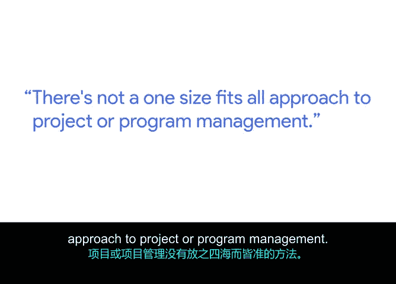

# 谷歌项目管理：专业证书 第3课：《项目规划：将一切整合起来》｜project-planning-google｜ - P49：49_05_02_丹：项目文档的重要性.zh_en - GPT中英字幕课程资源 - BV1Y94y1r7gw

I'm Dan and I'm a program manager at Google Research as a program manager in research I work to make sure that all of the teams I work with are on the same page。

 whether that's product teams who are implementing the research or research teams who need to understand kind of what how to define their research agenda for future projects。

So a lot of what I do is is effective communication and trying to create kind of detailed documentation so that everyone can kind of connect the dots。

 One thing that I've observed is a program manager is kind of a proliferation of documents or what I like to call death by 1000 documents。

 So it becomes really important to to have one kind of master document where you centralize all the kind of sub documentscuments or smaller docs that you might need to execute a project。

 And then you can just go to the master document and find what you need。

 even if that lives somewhere else。 So I can go into my like kind of master tracker。

 and I can find the program charter。 I can find the budget， I can find the agreed upon scope。

 Any document that has like approval matrices， which is like a list of all the approvals I need things like that。

 If I can link out to everything from just one place。

 I know that I'll always be able to start there and find what I need。

 There's not a one size fits all approach to project or。😊，managementage。

So you might need a risk management plan for one project， but not another。

 And there might be some other type of documentation you need。

 So really keeping everything organized and and starting from one place is is the most helpful tip I can give a broader trend in program management or project management documentation I that you don't just take one pass at a document。

 You don't finish your your project plan or your project charter in one go。

 You have to constantly return to it， revise it。And continue to。

 it's a living and breathing document。 And the more detailed you can be in your documentation。

 the fewer iterations you're going to need to go through later on。

 because they're more likely to get things right the first time。

