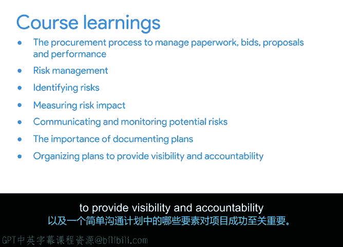

# 谷歌项目管理：专业证书 第3课：《项目规划：将一切整合起来》｜project-planning-google｜ - P50：50_05_04_课程总结.zh_en - GPT中英字幕课程资源 - BV1Y94y1r7gw

You've done a lot of work so far， Let's take a moment to review all you learned in this course。First。

 you learn the key components of the planning phase and explore how proper planning ensures that milestones and tasks are completed。

Next， you learned why it is necessary to create and manage a project plan。

How to utilize time estimation methods to prevent project failure？

How to get viable estimates using soft skills and which tools you can use to build a project plan。

 Then you learned what the components of a project budget are。

 how the budget process works and the concepts behind estimating and tracking a project budget。

And we discussed how the procurement process flows to manage paperwork， bids。

 proposals and performance。You also learned about risk management and how it helps prevent project failure。

You learned how to identify risks and measure their impact on a project and how to communicate and monitor potential risks once they're identified。

Finally， you learned how important it is to document plans。

You learned how to organise plans to provide visibility and accountability and what elements of a simple communication plan are vital to project success。

In the next course， you'll continue on to executing and closing a project where my colleague Eliita will be your guide。

She is going to teach you all about tracking and measuring project progress。😊，Risk management。

 using data to make decisions and effective project communication。

I had a wonderful time sharing my project management experience with you。 Best of luck。😊。

