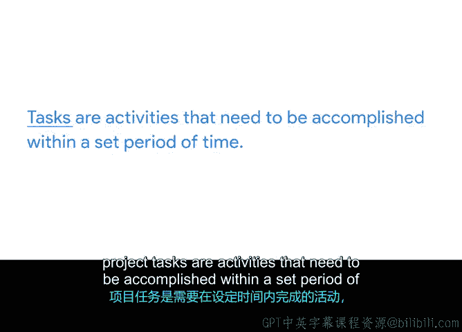

# 谷歌项目管理：专业证书 第3课：《项目规划：将一切整合起来》｜project-planning-google｜ - P5：05_01_01_理解任务与里程碑.zh_en - GPT中英字幕课程资源 - BV1Y94y1r7gw

Hi again， as we've discussed throughout this program。

 the project manager is responsible for assigning work to the team and keeping track of the project's progress。

When we discuss assigning work， we'll use a few key terms， project milestones and project tasks。

 Let's break these down。A project milestone is an important point within the project schedule that indicates progress and usually signifies the completion of a deliverable or phase of the project。

These are significant checkpoints in your project and keeping track of them helps ensure that your project is on schedule to meet its goals。

For example， a milestone might include completing the first draft of a report。

 and the goal may be to ultimately publish the report。

 Another example of a milestone is receiving sign off or approval from your customer on a major deliverable。

Let's discuss how milestones differ from project tasks。

A project task is an activity that needs to be accomplished within a set period of time。

The work of a project is broken down into many different tasks。In order to reach a milestone。

 you and your team must complete multiple tasks。 For example。

 if a milestone is completing the first draft of a report。

 the tasks required to get to that milestone might include hiring a writer。

 conducting research and drafting different sections of the report。

 Let's imagine milestones and tasks in the context of project plant powers at office screen。

One of your project deliverables is to launch a website for your new service。

 where customers will be able to place orders and get customer support。

Some of the milestones leading up to that launch will include securing approval on the website design and implementing feedback from user testing to achieve those milestones。

 your team needs to complete multiple project tasks， for example。

 in order to reach the design milestone your website designer will need to create initial mockups of the proposed website design。

You will need to review those mockups and the designer will need to implement your feedback。

Each of these items is a project task， and you won't reach your milestone until they're complete。

To review， milestones are important points within the project schedule。

 and project tasks are activities that need to be accomplished within a set period of time to help reach those milestones。

Milestones and project tasks are interconnected tasks ladder up to milestones。

 which are crucial for project tracking。Now that you know more about milestones， project tasks。

 and how the two differ， we'll learn more about the importance of milestones in the next video。

 I'll meet you there。