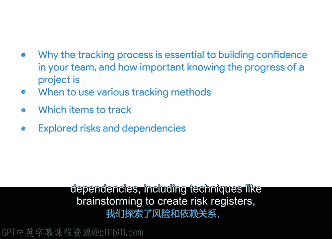

# 谷歌项目管理：专业证书 第4课：《项目执行：推动项目》｜project-execution-google｜ - P12：12_01_01_总结_1.zh_en - GPT中英字幕课程资源 - BV1Eu4y1i7Zk

Congrats， you've reached the end of this section。 We've covered some really important aspects of implementation。

 tracking and quality in this course。 We discuss why the tracking process is essential to building confidence in your team and how important knowing the progress of a project is to communicate this。

 You learn how to use various types of tracking methods like Gt charts。

 road maps and burn down charts。 You also learn that road maps are suitable for tracking high level milestones。

 Gantt charts are useful for projects with many dependencies and burn down charts are better for more granular task oriented projects that are on a tight schedule。

 You learn which items to track， using these charts， including costs， the status of key tasks。

 progress toward milestones， incoming action items and important decisions。

 We explored risks and dependencies， including techniques like brainstorming to create risk registers。

😊。

And we took you through the Rome technique， which stands for Resved， owned， accepted and mitigated。

You also learned about changes and dependencies and how they impact a project。

 We also discussed managing and communicating those risks， changes and dependencies。 that is a lot。

Well done。 coming up will take you through managing quality and continuous improvement。Me you there。

