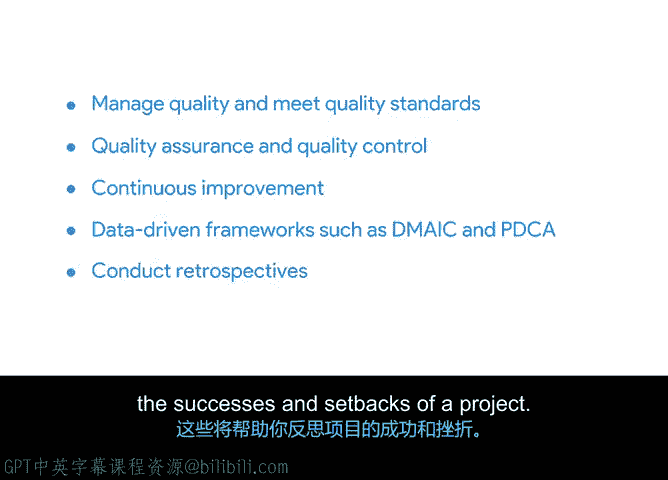

# 谷歌项目管理：专业证书 第4课：《项目执行：推动项目》｜project-execution-google｜ - P13：13_02_01_质量管理与持续改进介绍.zh_en - GPT中英字幕课程资源 - BV1Eu4y1i7Zk

Welcome back your cruising right along into your next topic in this section of the course we'll teach you all about how to manage quality and meet quality standards you'll also learn about quality assurance and quality control We'll take a look at continuous improvement and how to use data driven frameworks such as Damai and PDCA in order to work toward continuous improvement。

You'll also learn how to conduct retrospectives， these will help you reflect on the successes and setbacks of a project。

Finally， you'll learn about the importance of maintaining a positive。

 blameless tone throughout the process。Are you ready to jump right in？

Let's start with quality management， I'll meet you in the next video。

