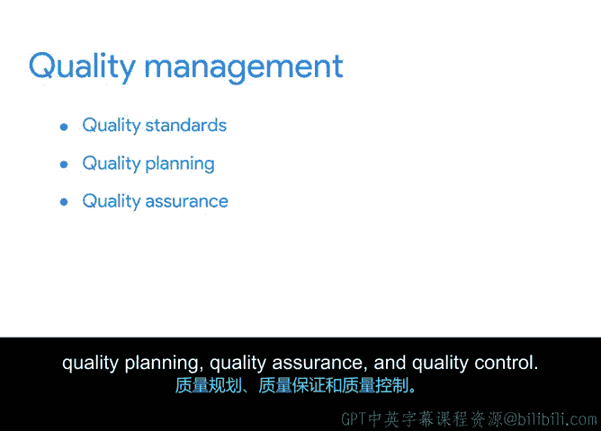

# 谷歌项目管理：专业证书 第4课：《项目执行：推动项目》｜project-execution-google｜ - P14：14_02_02_关键质量管理概念.zh_en - GPT中英字幕课程资源 - BV1Eu4y1i7Zk

Hi again， in this program， we've discussed that when you're managing a project。

 you always have to consider the triple constraint， time， scope and budget。

Each of these three elements will impact the project。 And if any one of them suffers。

 the overall quality of the project suffers。 Too。 There is an important distinction between quality and done。

 Simply finishing a project isn't enough。The project must meet the customer' standards of quality。

 rather than just be completed， like all things in project management。

 The more effectively you communicate with your team。

 the more likely your team will produce high quality deliverables。

So how do we define quality in a project management sense。

 Quality is when you fulfill the outlined requirements for the deliverable and meet or exceed the needs or expectations of your customers。

When it comes to quality， it's important to deliver a product or service that meets your customers' needs。

To meet their needs， you have to know important quality management concepts and oversee the implementation of a project management quality plan。

To set yourself up for success， you should consider the four main concepts of quality management。

 which are quality standards， quality planning， quality assurance， and quality control。

The quality process begins with setting quality standards。

 qualityuality standards provide requirements， specifications or guidelines that can be used to ensure that products。

 processes or services are fit for achieving the desired outcome。

Set quality standards with your team and your customer at the beginning of your project。

 Take the time to define the quality standards and criteria for your current work so that your team members and stakeholders understand exactly what they are。

After you set those well defined quality standards。

 you'll want to check in periodically and make sure everything looks okay and the requirements are met。

Remember that well defined standards and requirements lead to less rework and schedule delays。

Let's put this in an example using the scenario we've been using throughout the program。

 You're a project manager at Office Green， a company that specializes in Plan decor for offices and other businesses。

And you're leading a project called Plant Ps， a new service that will provide top clients with desk friendly plants。

Here's an example of a few quality standards for this project。Reliability standards。

 each planter arrives by the agreed upon time and in good condition， ready to be placed at a desk。

 And the suppliers have enough plants in their warehouses to fulfill the customer demand on time。

Usability standards。Planters won't cause customers allergic reactions or illness and will be suitable for all people and animals。

 if necessary。Similarly， you may have product standards。

 The supplier should meet your brand's look and feel。

 Use the specified materials and be delivered intact。

You should adhere to quality standards across all products and processes。For instance。

 you may have usability standards implemented in the website development process by stating that the website must be easy to navigate whether from a phone。

 computer or tablet。Next up， quality planning。Quality planning refers specifically to the actions of a project manager or the team to establish and conduct a process for identifying and determining exactly which standards of quality are in fact relevant to the project as a whole and how to satisfy them。

To steer that discussion， you can ask yourself， what outcome do my customers want at the end of this project。

What does quality look like for them？How can I meet their expectations and how will I determine if the quality measures will lead to project success。

This is where you'll plan the procedures to achieve the quality standards。

 Re that one of the project plant pals quality standards is reliability。

 The expectation that each plant arrives on time and in good condition。

 So as a quality planning measure， you'll need to make plans with your plant provider to test the durability of your planters before you decide to use them。

 The third concept， a quality management is quality assurance。Quality assurance。

 often shortened to QA， is all about evaluating if your project is moving towards delivering a high quality service or product。

Unlike quality standards and quality planning， QA spans the whole project lifecycle rather than taking place at a specific phase。

Your quality plan。Should include regular audits to confirm that everything is going to plan and the necessary procedures are being followed。

Regular check ins and reporting to stakeholders will help boost their confidence and yours along the way。

Quality assurance is where you'll make sure that you and your clients are getting the exact product you contracted for。

 So at Project plant Ps， this is where your team will inspect options for planters and perhaps sit in on the durability testing。

 If you make plans for your plant provider to handle the durability testing on their own。

 make sure you are tracking their progress and checking in regularly。😊。

The final concept of quality management is quality control。 often Jordan to Q C here。

 techniques are used in order to ensure quality standards when a problem is identified。

 or if the quality plan is not executed in the desired manner and corrective actions should be affected。

Quality control involves monitoring project results and delivery to determine if their meeting desired results or not。

 if not， then alternative actions should be taken。Quality control is also integral to creating a more successful landing for the next project。

After the plans are placed throughout the customer' offices。

 quality control may look like you or your team member taking a final walkthrough of the offices where the plants were delivered。

You'd be checking for things like broken planters or plants that were damaged in transit and swapping them out when necessary。

 You may not do this for every customer， but it's a good idea to do it as you're starting out in case you spot issues to improve upon when you're back in the office。

If you stuck to your quality plan， checking on quality throughout the life cycle of your project。

 Q A and， of course， correcting as needed。 Q， C， the likelihood of meeting your quality standards is high。

 resulting in a high quality deliverable at the end of your project that satisfies your organizational goals and exceeds the customer's expectations。

 And there you have it。 qualityuality management。Great。

 so now we've learned more about how to identify and explain the concept of quality management。

 which include quality standards， quality planning， quality assurance and quality control。😊。

In the next video， we'll discuss how to use soft skills like negotiating and practicing empathy to meet customers' needs in terms of quality。

 Meet you there。