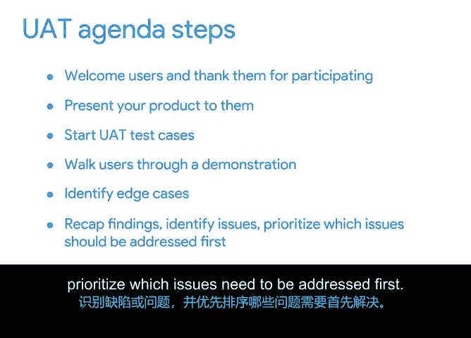

# 谷歌项目管理：专业证书 第4课：《项目执行：推动项目》｜project-execution-google｜ - P16：16_02_05_衡量客户满意度.zh_en - GPT中英字幕课程资源 - BV1Eu4y1i7Zk

Hi again， as promised， we're going to discuss user testing and feedback。

 If the end goal of our project is to have a great quality product or service for both our own organization and our customer。

 We need to get an idea of what the customer wants。😊。

We already learned how to make sure something is high quality on our end。

 now let's find out how to measure what clients want so we can meet their needs。

 expectations and standards。The best way to get an idea of what customers and users want is to ask them。

 but we don't mean calling each of them up on the phone and literally asking them。

 that might not be the best use of our time。Fortunately。

 there are a few ways we can streamline that information。

We can conduct a series of surveys or tests with customers and users。

Some common ones are feedback surveys and user acceptance tests。

Let's start with feedback surveys feedback surveys are a survey in which users provide feedback on features of your product that they like or dislike。

These surveys can take place as you design before you launch in order to find out if people like and understand the product or after you've launched。

 if you want to make sure the user experience is even more satisfying。

So your users participate in a survey and give you feedback on what features they like or dislike。

 And potentially， which aspects they find to be fairly intuitive and which aspects are a little tougher to navigate。

 After you get that feedback， you'll either be good to launch if you haven't yet。

 or you'll go back and iterate on the product。 if it's already on the market。Alternatively。

 you might conduct user acceptance tests。In broader terms。

 a user acceptance test or a UATT is a test that helps the business make sure that a product or solution works for its users。

A U A T must meet the agreed upon requirements and deliver the expected results。

 This test is typically used to assess the end to end experience for the user of a new process or product。

A user acceptance test is incredibly important because it takes place near the end of a product's development and therefore is an overall user experience test of the entire product。

 software or service。UATs are sometimes referred to as beta tests。

Let's find out what a user acceptance test agenda might look like in a typical UATT setting。

 you'll welcome your users and thank them for participating。Then you'll present the product to them。

This includes discussing testing guidelines and demonstrating how the product works。Next。

 you'll start your UATT test cases taking your audience through critical user journeys。

A critical user journey is the sequence of steps a user follows to accomplish tasks in your product。

When presenting something you've built， you must give users a visual representation or mock up of your product or have them go through a demo。

 For example， if you're working on a construction based project and you intend to replace all appliances in hardware in the home。

 youll want to give the user some sort of vision of what that might entail。

 this could include 3D models， digital blueprints， samples and more。

Your U A T demo should focus on a call to action。 For instance。

 the call to action for your project may be the need to test hardware in the client's future home。

 Maybe the homeowners have requested dishwasher that can be opened and closed with very little force and doesn't make too much noise。

In that case， you'll want to give the client real life scenarios to work with them。

Ask them to load the dishes and start the wash cycle。 Then ask questions like。

On a scale of one to 10。How much force was required to open and close the dishwasher to determine if the washer meets their expectations。

During your presentation and walkthrough of the UAT。

 you should be collecting feedback from the users on their overall experience。

During this part of testing， your users will be able to help you identify edge cases。

 Edge cases are rare outliers that the original requirements didn't account for。

 They deal with the extreme maximums and minimums of parameters。For example。

 imagine that you created an app that allows for unlimited photo uploads。

 knowing that users will rarely upload more than 100 photos in a single session。

 How will the system deal with someone who actually does upload thousands of photos or millions in a single upload。

It's unlikely， but it could be disastrous for your software。 After identifying edge cases。

 the last step of the UAT agenda is to recap your findings。

 identify bugs or issues and prioritize which issues need to be addressed first。

When you've addressed the issue and determined next steps。

 you'll be able to close and conclude your user acceptance testing， and there you have it。

So we've learned a bit more about the importance of listening to feedback from customers and discuss some common methods for measuring customer satisfaction like feedback surveys。

 user acceptance tests and edge cases。 That's a lot to learn。 Keep it up。 You're doing great so far。

In our next video， we'll pivot to identifying reasons why risks and changes might occur and how to manage dependencies。

 I'll see you soon。