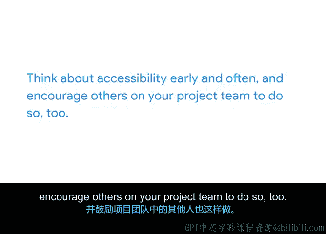

# 谷歌项目管理：专业证书 第4课：《项目执行：推动项目》｜project-execution-google｜ - P17：17_02_06_确保反馈收集过程中的可访问性.zh_en - GPT中英字幕课程资源 - BV1Eu4y1i7Zk

Hello again。 I'm Holly。 If you've been following this program from start to finish。

 you may remember me from an earlier course where I shared a bit about accessibility and why it's so important to keep it in mind as a project manager。

😊，So far， you've learned the importance of managing， communicating and measuring quality。

 This is a great opportunity to also think about how to ensure the ways you are collecting feedback and the processes in place to measure quality are fair and accessible。

😊，First， if you are collecting feedback through live interviews。

 be sure to include an offer to provide accommodations in your correspondence when setting up the sessions。

 you may get a quest for live captioning or an interpreter。 Other folks。

 such as those with anxiety or on the autism spectrum may ask to see the questions in advance so that they have time to think about and prepare their answers。

 Remember what works for one person may not work for another person。

 Even if those two people have the same disability。If you are conducting an interview on location。

 examine the space with an accessibility lens， like ensuring there is an accessible path into the building and the room。

 and that hallway is a clear clutter that could block someone using a wheelchair or walker or someone with a visual impairment from easily and safely moving through。

 if sending a survey or collecting feedback using technology。

 check that the systems you are using are fully accessible。

 If you are unsure contact the system owner and asked if they are compliant with the latest web content accessibility guidelines or WCag。

😊，Be prepared to provide questions and collect responses in an alternate manner， if needed。

Beyond collecting feedback as a project manager， it's important for you to make accessibility part of the conversation from the beginning。

 especially if your project pertains to a process or product。Oftentimes。

 incorporating accessible features into a product is overlooked or left to the final stages of a project and can lead to serious implications like launch delays or worse a product that can't be used by a percentage of the population。

Ensure your developers are familiar with accessibility requirements at the start。 If they're not。

 help connect them with appropriate resources or experts。

 includenc testers with various disabilities in your usability testing whenever possible。

 And at the very least， have the product tested board adherence through accessibility guidelines。

In summary， think about accessibility early and often and encourage others on your project team to do so。

 too。😊。

Coming up， you'll practice ways to measure quality and learn more about managing changes。

 risk and so much more。 Keep up the great work。😊。