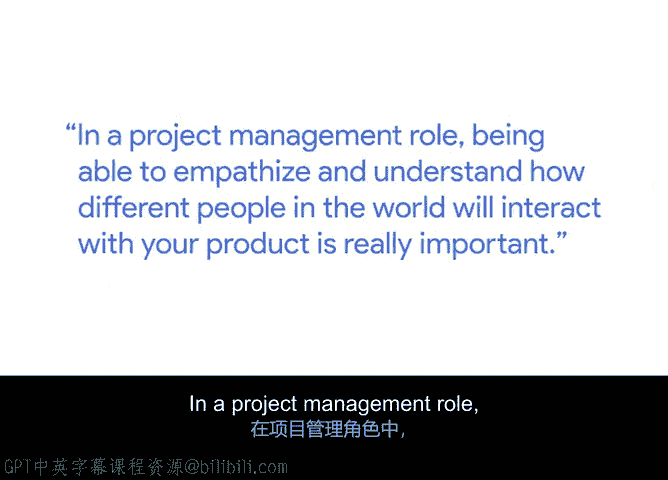
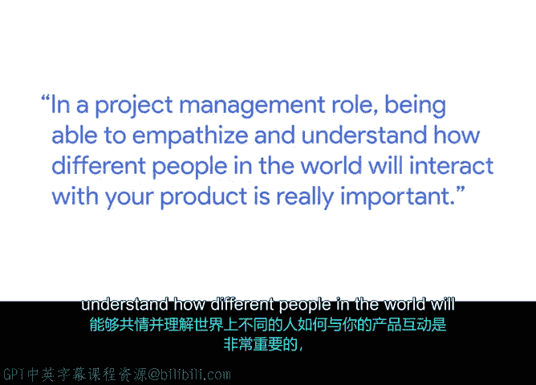

# 谷歌项目管理：专业证书 第4课：《项目执行：推动项目》｜project-execution-google｜ - P18：18_02_08_Sue-理解客户需求的重要性.zh_en - GPT中英字幕课程资源 - BV1Eu4y1i7Zk

Hi， I'm Sue， I'm a technical program manager for Google support Platform。

A technical program manager is responsible for making sure the team delivers on what it sets out to do。

That means pulling together a lot of different capabilities and deliverables coming from across many teams to pull together a product that we deliver to our customers。

 Without customers， There's really no reason to be building anything。

And what's interesting about building projects and working with customers and trying to imagine what they want is it puts you in this really unique place where you need to put yourself in their shoes and sort of imagine the world or imagine the product through their eyes in a project management role being able to empathize and understand how different people in the world will interact with your product is really important。

And gives you this amazing perspective。 Understand the customers' needs is a very difficult job。

 but it's really important。 And I believe it's a skill you can develop over time。

 I actually consider a customer just a certain kind of stakeholder。

 So I like to take my stake and group them into buckets。 So I have customers。

 and they are usually the end users of a product or the ones that are purchasing the product。

 And then I have stakeholders that are sponsors， rather。

 the people that are funding the team that's actually building this。

 Those two groups of people are very different。 And I like to。😊。

Treat a sponsor in a very special way。 They are looking to increase their return on investment。

And so you always need to be looking for ways to quantify。

 how are you generating a return on that investment。

 There's always this little fear that they're not going to get what they paid for and。

Giving them information frequently and at the right level of detail is a really important skill to have as a project manager。

 Sometimes you can overwhelm them with too many details and they cannot see the forest through the trees。

 And sometimes you don't give them enough detail and they don't trust what you're telling them。

 And so striking that balance is is really important。

 I really enjoy seeing a project from the very beginning to the very end。

 when you actually get to show it to a customer and get their acknowledgement and recognition and see their excitement at seeing the product actually working。

 something that when you just started， there was nothing， just ideas and and maybe some papers。

 And then， you know， however， many months later， you actually have a product that you can show off。

 What I love about project management is it puts you in that role so you can really see things from the beginning to the end。

😊。