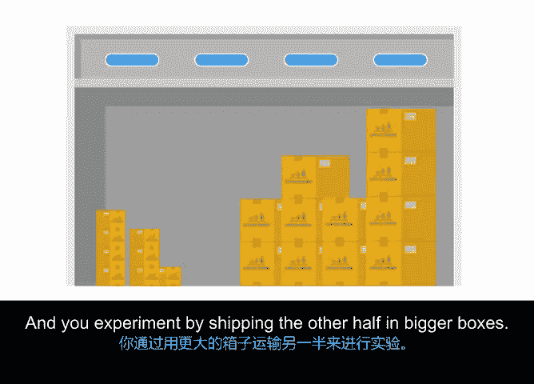

# 谷歌项目管理：专业证书 第4课：《项目执行：推动项目》｜project-execution-google｜ - P19：19_02_01_持续改进与流程改进.zh_en - GPT中英字幕课程资源 - BV1Eu4y1i7Zk

In this video， we'll explore how to advocate for and create continuous improvements in a project by learning about process improvements。

 Continuous improvement is an ongoing effort to improve products or services。

 It helps ensure that a project steadily makes its way toward the best possible outcome。😊。

Continuous improvement begins with recognizing when processes and tasks need to be created。

 eliminated or improved。Then a project manager must plan for and implement changes to keep the project on track。

 That's where process improvement comes from。 process improvement is the practice of identifying。

 analyzing an improving existing processes to enhance the performance of your team and to develop best practices or to optimize consumer experiences。

 When working through process improvements using a controlled environment in an experiment can help you understand if the changes you're considering。

 fix your problem。 A control is an experiment or observation designed to minimize the effect of variables。

 Control groups are representative samples that help you to determine that the differences between your experiment groups and the norm are due to your changes rather than something else。

😊，They eliminate alternative explanations for your results。If you aren't familiar with this。

 that's okay， because I'll break it down for you。 For example。

 you observe a problem with your process and put forward a hypothesis。

 which is an educated guess about what's causing the problem and how you'd fix it。

 Then you change one variable in the system。 Keep in the control group the same。

 and observe your results again。Let's put this in the context of project plant pals scenario。

 Business is booming for office green and demand for your team's new plant pal service is rapidly growing to meet the demand。

 suppliers have streamlined their process of packing boxes and putting all plants into a one size fits all box。

 Let's say you're using just one box size to ship all of your plants。For smaller plants。

 there's more padding added to the box to fill the extra space， and the plants usually arrive intact。

But larger plants have to be squeezed into the boxes and sometimes arise damaged。

 According to customer surveys。 to fix this problem。

 you hypothesize a potential solution by posing a question。

 would more of the large plants arrived intact。 If they were shipped in bigger boxes using the same padding we used for the small plants。

 Here is where your control comes in。 You continue to ship half of the larger plants in the original boxes。

 This is your control group。 and you experiment by shipping the other half in bigger boxes。

 Nothing else is different about the boxes except the size。 The shape， thickness， box supplier。

 delivery addresses absolutely everything else stays exactly the same。

 After the larger plants are delivered， you conduct a new survey。

 If more larger plants arrived intact。 Your hypothesis is confirmed。

If the results are the same as they were before the experiment。

 you'll need to try something else to solve the problem of your damaged plants。

Working in a controlled environment isn't the only way to ensure continuous improvements。

 There are various data driven improvement frameworks like Da Maci and P D， A。

I'll define those and present them in the context of plant pals in the next video。 See you there。

