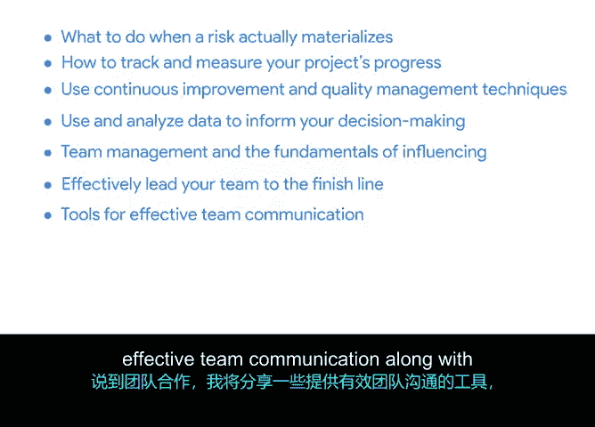

# 谷歌项目管理：专业证书 第4课：《项目执行：推动项目》｜project-execution-google｜ - P1：01_01_01_课程4介绍.zh_en - GPT中英字幕课程资源 - BV1Eu4y1i7Zk

Hi there， if you've gone through our previous courses。

 you spend a lot of time digging into the intricacies and significance of setting up a project for success。

And now we're at the project execution stage where all of that hard work comes together。

If you haven't gone through our previous courses yet， we recommend checking them out。

🎼Before we get started， let me introduce myself。 My name's Eliita。

 and I'll be your instructor for this course。I work as a senior engineering program manager at Google。

 where I currently lead the team behind routing and navigation on Google Maps。

 I joined the company in 2007， working on teams across Google's engineering organization in New York。

 London and Seattle。 And in 2013， I joined the Google Maps team and launched popular features like holiday hours and attributes on businesses。

 while leading global teams from New York to Sydney to Hyderabad。 General。

 I like solving problems and learning new things。😊，Every new project and team allows me to do both。

 I'm excited to lead you through this course and demonstrate how to put a project plan into action。😊。

First up， you'll learn more about risks and unforeseen changes to the project。

 If you've taken our previous courses， you might recall that change is inevitable。

 And to combat that， we've covered the concept of risk mitigation during the planning phase。

And now we'll take it one step further and discuss what to do when a risk actually materializes。Next。

 I'll discuss tracking and quality。 You'll learn how to track and measure your project's progress。

 and you'll learn how to use continuous improvement and quality management techniques to keep the project on track and running smoothly。

 These best practices are valuable to just about any role。

 And I'm looking forward to taking you through them。😊。

Other big aspects of running a project include decision making。

 You'll learn to both use and analyze data to inform your decision making and then， in turn。

 use that data to explore and explain key aspects of your project。

 I'll also discuss team management and the fundamentals of influencing。

 so much of the success of a project， relies on teamwork， and you'll learn more about how you。

 as a project manager can effectively lead your team to the finish line。 Speaking of teamwork。

 I'll share some of the tools that provide effective team communication。

 along with tips for organizing and facilitateating meetings。

And then we'll wrap up by discussing how to close a project you'll learn the steps required to finish a project and the importance of celebrating a job well done with your team sounds kind of fun right After all that planning this is the point in the project lifecycle where work gets done and everything comes together。

Ready to get started， meet me in the next video where you'll learn about the importance of tracking and measuring project progress。

