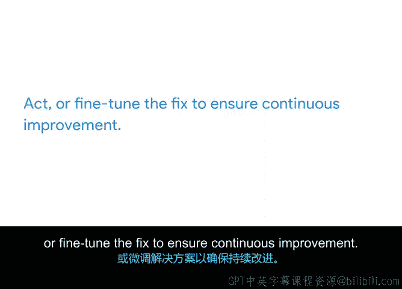

# 谷歌项目管理：专业证书 第4课：《项目执行：推动项目》｜project-execution-google｜ - P20：20_02_02_数据驱动改进框架.zh_en - GPT中英字幕课程资源 - BV1Eu4y1i7Zk

In the last video， I introduced the concept of continuous improvements。

 we explored in depth how working in a controlled environment can optimize your outcomes。

In this video， we're going to keep on that same path of uncovering methods for continuous improvements。

We'll start with data driven improvement frameworks data driven improvement frameworks are techniques used to make decisions based on actual data。

The first data driven improvement framework we'll cover may be familiar to you since we discussed it in a previous course。

 recall that。DM AIC， or Da Maci stands for Def， measure， analyze， I and Control。

And it maps out to five steps that you can take when working toward continuous improvements。

So when considering how you can improve customer experiences， start with the following。 first。

 you'll need to find the business problem， goals， resources， project scope and project timeline。Next。

 measure。 Here you'll conduct performance metrics and data collection to establish baselines and measure success。

Then analyze， work to find the root causes of problems and understand their impact。Next， improve。

 This means implementing a reasonable solution to the problem。Lastly。

 Control this is where you'll implement the changes and stay on top of monitoring the updated processes you've established。

Another framework you can refer to when working through continuous improvements is PDCA。

PDCA is a four step process that focuses on identifying a problem， fixing that issue。

 assessing whether the fix was successful， and fine tuning the final fix。The steps are as follows。

First， plan。Here， you'll identify the issue in root cause and brainstorm solutions to the problem。

Let's say that one type of plant isn't selling well。

 which means the warehouse is full of a particular species。If you don't do something fast。

 the plants may die soon。So what are some viable solutions？

You propose moving the items from the bottom of the sales page on the website to the top。

 So those plants are front and center。You could also send out email marketing campaigns featuring that plant where you offer customers a buy one。

 get one offer on the plan。Second do， or fix the problem。In this case。

 your sponsor decided that they didn't feel comfortable giving plants away if they could still profit。

 So you've decided to go with the first option，Moving the plant to a more prominent part of the website。

 Your hypothesis is that the best way to shift older inventory is to put it in a place that customers can't miss。

 The next part of this framework is check。 Compare results to the goal to find out if the problem is fixed。

Now you wait one week and notice if the sales numbers go up for that plant， if they did。

 your hypothesis is correct。And you've saved some plant lives and helped Office green avoid financial loss。

 Nice job。And finally， act or fine tune the fix to ensure continuous improvement。

In our example， you decide to reorganize the website In the future。

 all overstocked plans will get a prominent place on the website。Both PD， CAA。

 and Macy are great problem solving frameworks to apply in your day to day life and in the workplace。

These frameworks help you to identify issues， reduce errors， and optimize your processes。

I encourage you to think about these techniques next time you encounter a problem or notice room for improvement within a workflow。

You'll be surprised at how a simple framework can help set you up for success。Awesome。

 now you know more about advocating for and creating continuous improvements。

 We also defined and went through some examples of using frameworks to Macci and PDCA for process improvements。

😊，Now that， you know the basics of continuous improvement and process improvement。

 we'll discuss the differences between projects and programs and how they intersect。

 I'll meet you in the next video。