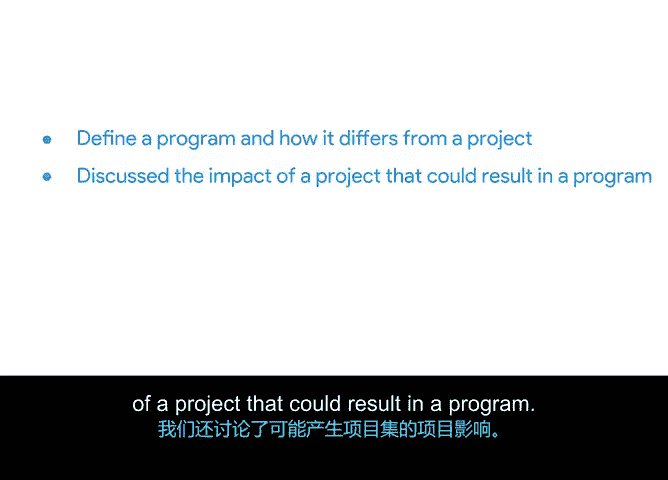

# 谷歌项目管理：专业证书 第4课：《项目执行：推动项目》｜project-execution-google｜ - P21：21_02_03_区分项目与项目集.zh_en - GPT中英字幕课程资源 - BV1Eu4y1i7Zk

By now， you know that a project manager interacts with their team members on a daily basis。

 What you may not know is that project managers are also part of a bigger ecosystem within their business or organization。

Projects are not the only endeavor a project manager may participate in。

 There are also programs and portfolios。A project is one single focused endeavor。

 A program is a collection of projects， and a portfolio is a collection of projects and programs across the whole organization。

 Think of it this way。😊，Projects can exist inside of programs， which can exist inside of portfolios。

Note that I said can， because this won't always be the case。Projects can also exist as separate。

 unrelated initiatives。But if they're part of something bigger within the organization。

Projects can become a program。The collective and separate successes of all of these three rely on continuous improvements。

So who are the people that manage these various endeavors and drive success？

Let's think of this organizationally， starting with a project manager。

A project manager oversees individual projects and has short term concrete deliverables。

The project manager is tasked with continuously improving their assigned project。

A program manager supervises groups of projects and even other project managers and focuses on long term business objectives。

This program manager is tasked with continuously improving their assigned collection of projects。

A portfolio manager supervises a grouping of projects and programs and provides centralized management to them。

This portfolio manager is tasked with continuously improving their assigned collection of projects and programs。

Different companies may have slightly different names for these rules， but the concept is the same。

Let's examine an instance where these rules directly create continuous improvement for their organizations。

A project manager has decided to offer monthly cross departmental trainings to members of their team。

Their team is small， so they figure it's helpful when people from other departments understand their workload and processes。

This way， if someone is out of office， there will always be coverage。

After a couple months of these trainings， the project manager realizes they not only improve processes in communication。

 but they act as inadvertent team builders。Because of the trainings。

 employees have the opportunity to interact and to get to know one another better。

The project manager takes this info to their program manager。

 and the program manager loves this unexpected insight。Now。

 the program manager can establish these trains across all of the projects that they're managing。

 making these continuous improvements program wide rather than just project wide。

So exactly what would projects， programs and portfolios look like at Office screen？

Getting the plant P service launched and running is a project。 It's short term and temporary。

Once the service is launched successfully， the project ends。

Keeping the service going indefinitely requires the project to become a program。

The program running the plant P service becomes one of Office Green's long term business objectives。

 and the company will work on continuously improving the program。 Now， plantt pals。

 along with other projects and programs at Office Green， are included in the company's portfolio。

As continuous improvements are executed in project plant Ps。

 the program and portfolios at Office Green will notice the benefits of that。For instance。

 let's refer to the example of overstocked plants from the previous video。

While using PCA plan do check act， you notice a drop in the sales of one of the plant varieties。

 So you decide to reorganize the website so the species that isn't selling is featured at the top。

 givingiving a small discount。 This change is so successful that you end up making it a best practice。

 From now on， Low performing an overstock plant varieties will be featured at the top of the website。

😊，This is， in fact， a new process。 runningning it over and over again will drive continuous improvements。

The continuous improvement you made to the project reflected well in your program and portfolio。

 because now that that's been tested， the same strategy can be implemented company wide for all of the company's。

 other sites and products， reducing waste and increasing revenue across the board。

If many or all of the projects at Office Green see the same improvement that directly benefits the program。

 which is the collective of the projects。If the same strategy is applied to programs at Office screen。

 the portfolio will directly benefit by having stronger indicators for profitability。 Great。

 So now we've learned how to define a program and how it differs from a project。

 We also discuss the impact of a project that could result in a program。

 and we learned how a project can turn into programs or portfolios。

 Now that you know more about how these three concepts work together。 Let's head to the next video。😊。

