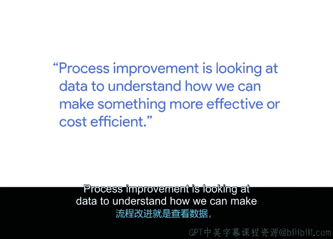
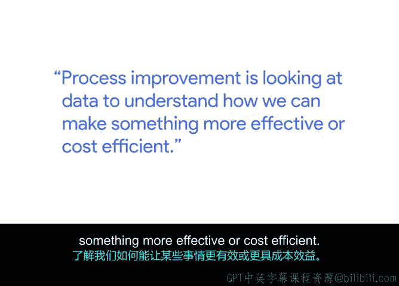
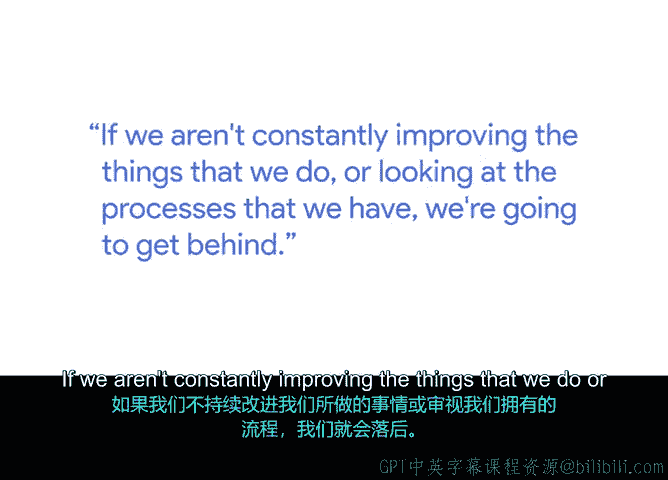
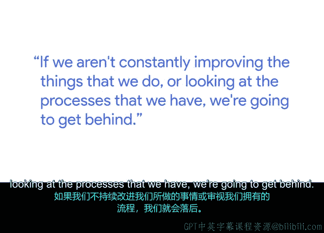

# 谷歌项目管理：专业证书 第4课：《项目执行：推动项目》｜project-execution-google｜ - P22：22_02_04_Jacob-培养持续改进思维.zh_en - GPT中英字幕课程资源 - BV1Eu4y1i7Zk

I'm Jacob。 I'm a product operations manager at Google。

 Product operations is not that different from a program manager。 I've had lots of different titles。

 I've been a solutions consultant。 I've been a program manager now I'm in product operations as a manager and really it's the same set of skills being able to organize people。

 take really complex ideas， make it simple for people to understand so that our teams can then work on those Product operations managers a really diverse role。

 Not only do we work with engineers， we work product， we work legal。

 but were really the voice of the customer， and so we have a really unique position where we get to take customer feedback whether that's coming in from a support channel and then be able to kind of work with product to build a solution。

 process improvement is looking at data to understand how we can make something more effective or cost efficientic。

😊。

When we work on projects， we are always taking a look at how we're managing things as see if we can be better。

 One example I can give is just taking notes。 seems super simple。

 but a lot of times what will happen is notes get taken and we forget to send it out again。

 We forget to send the email after so that people are updated。

 So we're constantly looking at new ways to do things like take notes。

 How do we organize the skills and the projects that we have。

 So that's part of the process improvement is definitely looking at the tools at our disposal and seeing if there's something new。

 Con improvements more mentality that we have on the team of constantly pushing ourselves。

 even if we feel like the product is at a good place to be better。 You know， working with technology。

 things are constantly changing。 And so we have to have that mindset of。😊。

Being continually trying to improve things， you can plan things out perfectly or what you think is perfect and there's always going to be something to come up。

Once you get something out in the wild， people will use the product in ways that you didn't even think about。

 And so that's where that idea of continuous improvement comes in because even when you think it's great。

 you need to be able to look at it， let your ego down and be able to solve those problems once you see how people are actually using it。

 It's critical to technology because it moves so fast， things change so quickly。

 if we aren't constantly improving the things that we do or looking at the processes that we have。

 we're gonna get behind。

We're always adding new features。 And so those always make new problems for us to try to solve If you believe that what you're trying to do is really for people and you forget about the numbers。

 you forget about all of that stuff。 you remember that your product is going to potentially make someone really happy or make someone potentially more successful in their business。

 Those are the kinds of things that really make me excited to work and puts away all of that frustration of the kind of lead up。

