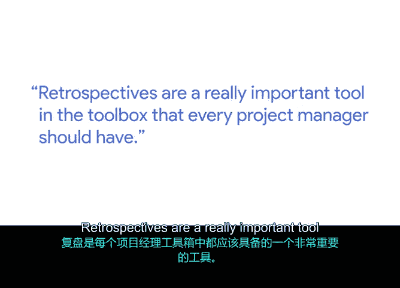
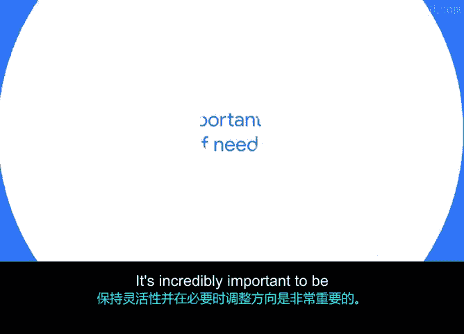
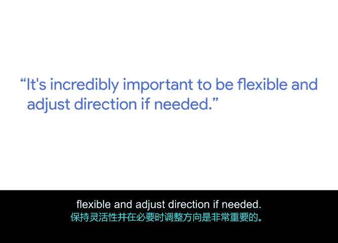

# 谷歌项目管理：专业证书 第4课：《项目执行：推动项目》｜project-execution-google｜ - P25：25_02_03_Gernot-利用回顾会议重回正轨.zh_en - GPT中英字幕课程资源 - BV1Eu4y1i7Zk

My name is Kernard and I'm a senior program manager here at Google New York I work for a department called Geo which is responsible for Google Maps and our Maps products on Google search a senior program manager is typically responsible for a set of projects and initiatives all the way from the ideation stage all the way through to getting them launched and landed something that happens to any project manager pretty much almost on a daily basis is that there's something unforeseen that happens and projects go off track Retives are really important tool in the toolbox that every project manager should have。

Often people say at the end of a project， okay now it's time to do a retrospective and you sort carefully looking at what are the things that happened that went well and that didn't go well and what are some of the learnings that you can apply to future projects but I really think of this more as a continuous exercise along the way like you really should be continuously checking in on how is the project going one example of where retrospective has helped us get back on track is we were working on the project where we were launching something on Google search halfway along the way we realized there's actually a better way to do this that would realize much bigger benefits to our users So as a result of that we really get the whole project team together and we really sort of talked through what is what have we done so far what is it that the current state of the project Yes。

 what are our options to go forward to help us address some of the shortcomings that we've now identified and then collectively replan the rest of the project to make sure we are sort of in a clear path forward and we have a clear understanding of how to get to that new sort of understanding of adjusted。

Success it's incredibly important to be flexible and adjust direction if needed。

Like if you know that there's a change that's needed and you know that the project is going in a bad direction。

 like continuing in that bad direction， obviously is the worst thing you could do for the project and for the company。

 so it's really important to as quickly as possible。

 sort of initiate that process of analyzing okay what are the options in terms of things that we can do to course correctr and make sure the project is often in a good direction and embark on that new direction as quickly as possible。

 obviously while taking enough time to make sure it's a data-dri decision。

 all the stakeholders ruless and sponsors are on board。

 the most important things to keep track of as a project manager really depend a little bit on the project that you're involved in and so really I think tightly managing the scope。

 tightly managing sort the resources， tightly managing against the timeline that you set out and really sort carefully assessing how things are going as you compare them to the plan that you laid out originally and you sort of make course corrections as needed based on the things that you see。

