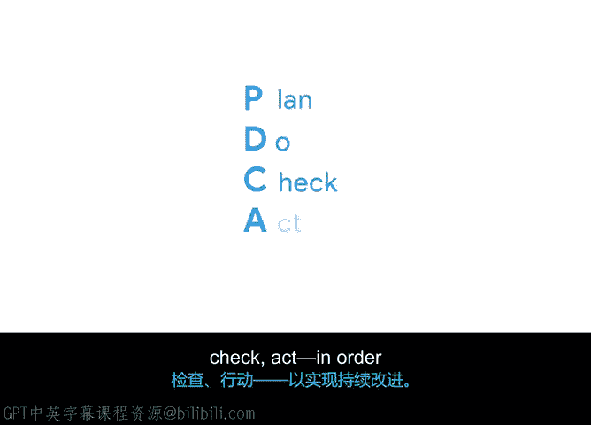

# 谷歌项目管理：专业证书 第4课：《项目执行：推动项目》｜project-execution-google｜ - P26：26_02_01_总结_2.zh_en - GPT中英字幕课程资源 - BV1Eu4y1i7Zk

Hi again。 This module featured a lot of information。

 We revisited familiar concepts and introduced so many new ones。 We discussed quality management。

 where we learned the four steps to ensure quality， which includes setting quality standards。

 quality planning， quality assurance and quality control。

 We covered continuous improvement and how to use data driven strategies such as Damaacy。

 which stands for define measure， analyze， improve control， and PDC A， which stands for plan。

 do check， act in order to work toward continuous improvements。

 We learned how to conduct and use retrospectives as a tool for future improvements。

 and how to facilitate positive conversation and encourage feedback from your team members in order to avoid mistakes later on in future projects。

 I'm really proud of how far you've come。 And I hope you are， too。

 I hope you take a moment to admire your progress and applaud yourself。😊。

In the next module， you'll learn about the importance of gathering data and how to make data driven decisions。

 I'll meet you there whenever you're ready。