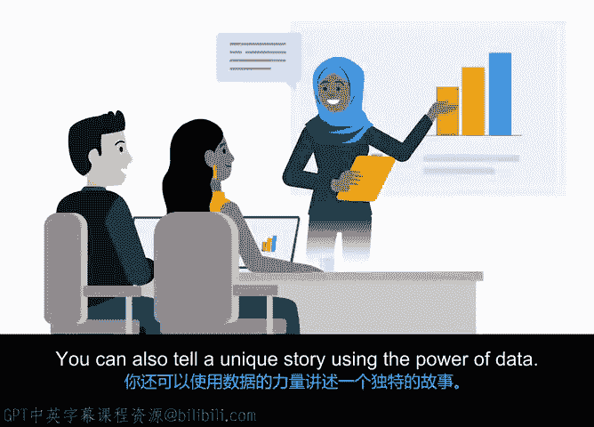

# 谷歌项目管理：专业证书 第4课：《项目执行：推动项目》｜project-execution-google｜ - P27：27_03_01_数据驱动决策介绍.zh_en - GPT中英字幕课程资源 - BV1Eu4y1i7Zk

。🎼Hi there。 It's great to have you back。 So far， we've talked about tracking and measuring project progress。

 We've also discussed how to manage quality through different techniques and the benefits of continuous improvement。

 Now， I'm going to tell you all about data and data informed decision making。

 You'll learn how data impacts decisions， some of which occur during a project journey。

 You'll get answers to questions like how do I use data in my project。😊。

Which types of data should I search for and how do I determine what stakeholders need to know？Now。

 more than ever， we have access to data at our fingertips on our computers， tablets and phones。

 We use data every day to view the stats of our favorite athletes。

 Ex our screen time on social media and monitor our health。😊，Data is a part of our daily lives。Take。

 for example， online job search sites。These companies collect basic data you enter like your previous experience。

 location， maybe any degrees or certificates you might hold。

 and use that information to determine potential job matches for you。

Jobs that don't fit the criteria of what you entered aren't likely to appear in your suggestions。

 This is just one way data is used to inform and influence our decisions。In this module。

 we'll discuss project data and how it informs decision making and helps to prevent both major and minor issues。

 We'll also discuss how project related data can be used to reach success metrics。

We'll go over common project data， such as tasks and issues and discuss how analyzing this data and other metrics impacts project productivity and quality。

 Finally， we'll demonstrate how data isn't just about numbers。

 You can also tell a unique story using the power of data。

Storytelling offers a memorable way to communicate important aspects of your project。

Pairing storytelling with data can convince stakeholders of ways to resolve problems and ensure a successful outcome。

 so data certainly has its benefits。There's a lot to learn about data and we'll lay out some of the basics so you can confidently tackle your projects ready to get started。

 let's get to it in the next video。