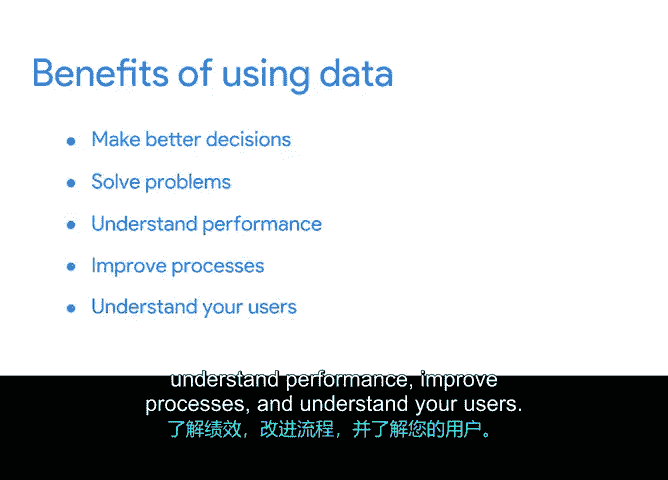

# 谷歌项目管理：专业证书 第4课：《项目执行：推动项目》｜project-execution-google｜ - P28：28_03_02_数据的价值.zh_en - GPT中英字幕课程资源 - BV1Eu4y1i7Zk

Hi there。 In this video， we'll explain the value of data and how it impacts your projects。

 We'll also cover how you use data to communicate with stakeholders。 Data is a big business。

There are 2。5 quintillion Bs of data created each day。 That's a lot of data and a lot of information。

 Let's start by talking about what data is。Data is a collection of facts or information。

 And through data analysis， you'll learn how to use data to draw conclusions and make predictions and decisions。

 We use data daily to help us make decisions and improve performance。 For example。

 my friend is a runner who participates in annual 5 km and 10 km runs。

 When she' is training for a run。 She uses the data on her GPS watch to measure her time and distance。

 She can even calculate her pace by measuring the minutes per kilom。😊。

She uses the minutes per kilometer data to track her performance over time so that she can focus on improving for the future。

 Similarlyly， companies use data and data analysis to improve and bring value to their organization in a variety of ways。

For example， companies source data on customer behavior and customer demand to provide better services and create new products。

 Netflix is a great example of a company that uses data intelligence to predict what customers want。

By observing data points surrounding types of genres， ratings and number of repeated viewings。

 Netflix recommends TV shows that they believe customers might like。 Therefore。

 improving the customer's viewing experience in the same way as a project manager。

 you can use data daily to make better decisions， solve problems， understand performance。

 improve processes and understand your users。 Let's examine how these benefits can impact a project。

😊。

Let's talk about how this can play out in our plant Ps project at Office Green。

If you have the data on customer buying patterns and identify that your best selling products are all tropical plants。

 you'll be able to make better decisions when placing new plant orders with your supplier。

 you'll also be able to better understand your users and their preferences to improve your offerings and performance。

Another daily benefit of data within your project team is the opportunity to improve processes。

If you have the data from your project tracker of the number of tasks completed。

 the number of escalations or the number of issues that come up surrounding an internal process。

 you'll be able to deduce where the majority of issues are stemming from。

This data will help inform your decision on where to focus your attention to improve the process。

While these are simple examples through critical analysis， application and execution。

 data becomes a powerful tool to guide any project in the right direction。Coming up。

 we'll discuss the types of project data you can use to do just that。

