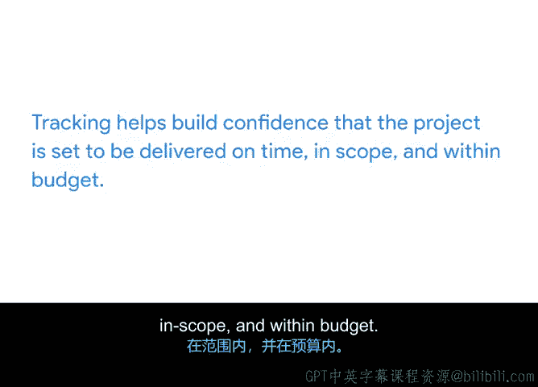

# 谷歌项目管理：专业证书 第4课：《项目执行：推动项目》｜project-execution-google｜ - P2：02_01_01_跟踪的重要性.zh_en - GPT中英字幕课程资源 - BV1Eu4y1i7Zk

Hi again， In previous courses， we've discussed the importance of breaking your project down into milestones and tasks and assigning those tasks to different members of your team。

 We've also discussed setting a schedule and budget。But once the project execution phase gets going。

 how do you actually know that the work is getting done。 Well， you can do this in a few ways。

 but primarily， you can keep tabs on project progress by tracking and measurement。

 This is actually a big part of project management。

 Tracking by definition is a method of following the progress of a project's activities。

 Measuring project performance regularly to identify deviations from the project plan can help ensure that the project stays on track。

 A deviation is anything that alters your original course of action。

 deviations from the project plan can be positive or negative。

 Are you ahead of schedule because a technical problem is less complex than you estimated。 Ts up。

 Did a natural disaster shut down your testing team。 Big thumbs down。😊。

Both of these are examples of deviations。 They're also examples of why tracking is such a crucial part of your role during the project execution phase。

 Let's examine some of the ways that tracking is beneficial for your project's success。To start。

 tracking makes key project information transparent and transparency is essential for accurate decision making。

 Even the strongest project managers make poor decisions when they lack information or context。

 Tracking centralizes project information so that everyone can understand the status of each part of the project。

 which can then help you identify gaps in your knowledge。 Also， Project have so many little details。

 It's hard to keep everything straight。Tracking helps ensure that you don't risk for getting something。

 Second， tracking helps keep all team members and stakeholders in touch with deadlines and goals to ensure that everyone has visibility into project progress。

 you should have a project plan that works both for you and your team。This way。

 you're all on the same page about how the project is progressing。

You'll learn about different ways to track a project later in this module。

 Tracking is also crucial for recognizing risks and issues that can derail your progress with effective tracking。

 you'll be able to identify issues in a timely fashion and work with your team to take corrective action by providing visibility into the various parts of the project。

 Tra helps you and your team identify and focus on areas at risk。 And finally。

 tracking helps build confidence that the project is set to be delivered on time in scope and within budget。

 Having a clear， up to date picture of the overall project status keeps the team motivated and focused on staying the course。

😊。

So to recap， tracking is important for a few key reasons like transparency。

 risk management and keeping the project on track Com up。

 we'll take you through some of the key items to track during project execution。 Me you there。

