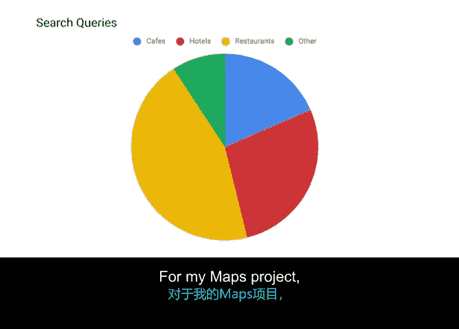

# 谷歌项目管理：专业证书 第4课：《项目执行：推动项目》｜project-execution-google｜ - P32：32_03_01_通过数据呈现讲述项目故事.zh_en - GPT中英字幕课程资源 - BV1Eu4y1i7Zk

Welcome back。 In this video， we'll discuss how to tell a powerful story using data。

 We'll teach you how to gather and organize your project data to present it to others within your organization。

😊，Presenting is a powerful way to communicate your ideas and support your decisions throughout the project journey。

Think of presenting as telling the story of your project storytelling is the process of turning facts into narrative to communicate something to your audience。

😊，Storytelling is how you bring data to life and is a useful way to tell stakeholders within your organization about your project。

In a way， we're all storytellers using information and experiences to share our ideas with others。

Stories usually have a beginning， middle and end to tell a great story using data will'll go over some best practices to make sure your story is complete。

 accurate and compelling。 In general， there are six main steps to storytelling。 First。

 define your audience。 Then collect the data。 Next， filter and analyze the data。 Fourth。

 choose the visual representation。 Then shape the story。 and finally， gather your feedback。😊。

Now let's review each one。Step one， define your audience。In this first step。

 it's important to know who you're presenting to。 Are you presenting to project sponsors or executives or to team members。

Define your audience and find out what matters most to them。

Begin by asking yourself qualifying questions like。

 what would my audience want to know about the project or what are their most urgent concerns？

Which key data points influence the story and project outcome？

This will set you up to know the type of story you want to tell and the type of data you should use to tell it。

For example， years ago I was working on a project for Google Maps。

Our goal was to apply a label to every business in the world。 Reants， hotels， gas stations。

 you name it。 There are many， many， many businesses in the world。

 And I only had a small team of engineers to work with。 For this project。

 we tailored our storytel to an audience of vice presidents from Google Maps and Google search。

 Both were important to consider， because we were helping users find and connect businesses through the Google Maps app and through Google search。

 I'll return to this example as I take you through the steps of storytel。😊，Next up is step 2。

 find the data that connects to the question you want to answer。

 You'll need to begin searching for data from trustworthy resources to support the point you're trying to make。

Leverage the relevant project resources and documents like your project plan or work management software to download and analyze key data points。

For my Google Maps project， the question we were trying to answer was。

 where should we focus our attention first， So to find the right data for this question。

 we turned to the many businesses in our internal database and the available information about what types of businesses users were searching for。

That brings us to step 3， filter and analyze the data。Now that you've collected your data。

 you'll need to vet it for credibility and filter the information for my maps project。

 we use search queries to determine the types of businesses that users search for most often。

 which included restaurants， cafes and hotels。 There were other categories， gas stations， museums。

 et cetera。 but they collectively made up a much smaller percentage of geospecific search traffic。😊。

Step four， choose a visual representation。Visualizations are a great way to help people remember the information you're presenting and on our essential piece of storytelling。

You can use data in different ways to tell a story like using dashboards， charts。

 infographics and mappings。 And we'll go over these examples in more detail in the next video。

For my maps project， we decided on a pie chart to help tell our story， which brings me to step five。

 shape the story。

After you've analyzed your data and know how you'd like to visualize it。

 it's time to tie it all together into one cohesive narrative。

Take some time to think about what you're hoping to achieve the points you want to make and the questions and concerns you want to answer for the Maps project。

 we use the pie chart to show that most geospecific search queries are covered by a relatively small number of businesses。

So we built a story about that data。 We wanted agreement from our VP to work on improving the data behind this set of categories in a few major markets and needed to illustrate that if we improve the category data。

 we'd succeed in improving the search results for more than 50% of geo searches。Lastly is step six。

 gather your feedback。Similar to how you may ask a friend to practice with you before an interview。

 you want to be sure that before you present， you do a trial run。

Try getting feedback from someone who's not connected to the project。 Find out if it was interesting。

 Did it make sense， What questions did they have。Their feedback can help you identify areas of your story that were unclear or unmemorable and give you a final chance to make adjustments to recap。

 you want to define your audience， collect the data， filter， and analyze the data。

 Choose a visual representation。 shape the story and finally gather your feedback。

 The key to effective story telling is to be organized， intentional and prepared。😊，Coming up。

 we'll talk more about step 4， effective visualization。 See you there。

