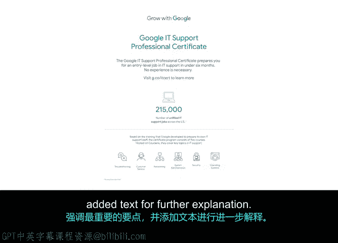

# 谷歌项目管理：专业证书 第4课：《项目执行：推动项目》｜project-execution-google｜ - P33：33_03_02_数据可视化工具.zh_en - GPT中英字幕课程资源 - BV1Eu4y1i7Zk

Hi there， in this video， we'll discuss data visualization and how it helps inform decisions for your project。

Data visualization is the graphical representation of information to facilitate understanding。

That can include graphs， maps， and tables to name a few。

Project managers use these visual representations for a few reasons。

 They're useful for communicating data to others because they help filter information by focusing the audience on the most important data points and insights。

Visualizations are also a more efficient way to summarize information because they condense long ideas and facts into a single image or representation。

 And crucially， they help their viewer make sense of and remember the information being presented。

Visualizations help aid information processing and enhance memory。

It plays an active role in the storytelling process by helping communicate project insights to your audience。

Let's go into some familiar types of data visualizations that project managers use throughout the entire life cycle of the project。

First， let's discuss a common data visualization tool used when running the project， a dashboard。

A dashboard is a type of user interface， typically a graph or summary chart that provides a snapshot view of your project's progress or performance。

It acts as a centralized location for project stakeholders to draw quick insights。

 It can display a tight summary of metrics， stats and key performance indicators or KpiIs。

A K P I is a measurable value or metric that demonstrates how effective an organization is at achieving key objectives。

 They serve as a great aid in helping your team and stakeholders understand if you are on the right track。

 In other words， they signal if you are making progress to reach your success criteria。😊。

In your dashboard， you may have a summary of your top KPIs or metrics and your progress to date。

For instance， if one of your objectives is for your project to reach a 95% customer satisfaction score at the end of a three month period。

 you may track that goal via thousands of customer satisfaction surveys。

Rather than displaying a spreadsheet of each response。

 a dashboard is a good place to summarize those results and showcase the average customer satisfaction score to see how you are pacing to your goal。

😊，Similarly， you could also include other key Kpis that signify progress。

 like a countdown that shows the number of days until project launch or the percentage of the number of issues resolved。

Many project dashboards may also summarize project plans。

 documents and reports in one place and provide a visual of the status of each of them。 For example。

 if your project plan has hundreds of tasks with varying degrees of completion。

 your dashboard may summarize the amount of tasks or milestones completed at that point in time。

 and the percentage of tasks that are in progress， completete or not started。

As you may start to notice， dashboards are great visualizations for efficient status updates because they enable you to group。

 summarize and highlight top project data points。😊。

Another visualization that does this is one that we mentioned earlier， a burn down chart。

A burn down chart is a line chart that measures the time against the amount of work done and the amount of work remaining。

The outstanding work is usually on the vertical axis with the time visualized horizontally。

This serves as a strong visualization to help the team picture the amount of tasks left to complete。

Similar to line charts， column charts are another popular graph used to signal project performance and progress。

Column charts are useful for comparing different activities or comparing progress over time。

For instance， you can show different outputs like the number of customers and the number of plants delivered year over year to demonstrate growth and change。

Pie charts are useful when showing the composition of something or the parts to whole relationship。

All of these simple charts offer visualizations that enable you to draw quick insights and help tell stories。

There are many more in the following reading that I recommend checking out and practicing。

Before that， there is a final visual tool that I want you to know about。Which is an infographic。

Infographics are visual representations of information such as data or facts and are typically in the form of what we call a Google a one pager or a one cheater。

The difference is that there are typically concise summaries of that data。

This is often done primarily through graphics or drawings。

 emphasizing the biggest points with added text for further explanation。

Use infographics to present complex information quickly， professionally and clearly。

 especially when you may not be present to share all of the details yourself。

Infographics should be able to communicate strong information without the need for extra support and explanation。

 These are just a few examples of data visualization and project management。 Remember。

 you'll want to use visuals to demonstrate and illustrate situations like changes over time。

 frequency， relationship correlations and to analyze value and risks。

Another important tip is to make sure that these visualizations are accessible。

As we mentioned before， you'll want to ensure that your data story is understood by everyone。

Check out the Resources tab on some of the best practices for accessible visualizations and communications。

Nice job now that you're noticing how to use data to effectively tell your story。

 we'll continue on to the final piece of this lesson。

 learning about presentation techniques to present your data， meet you in the next video。

