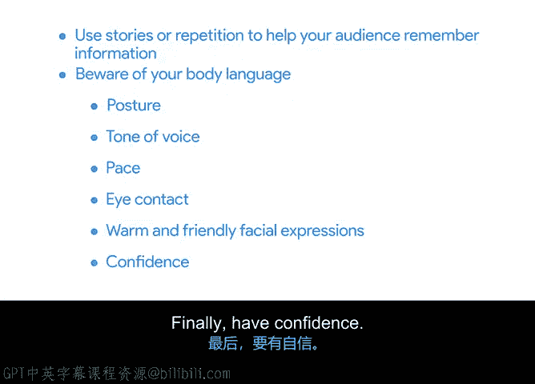

# 谷歌项目管理：专业证书 第4课：《项目执行：推动项目》｜project-execution-google｜ - P34：34_03_04_高效演示技巧.zh_en - GPT中英字幕课程资源 - BV1Eu4y1i7Zk

Hi， you've learned the process of crafting a narrative about your project。

 and you've learned how to visualize key data points that help you to tell that story。 Now。

 it's time to bring it all together。 In this video。

 we'll highlight some useful presentation techniques。😊。

Think about one of your favorite public speakers and why you enjoy their presentation so much。

 Is it their voice， their knowledge or the confidence they exude while speaking。😊。

Brene Brown is one of my favorite speakers。 She's widely known for her 2010 Ted talk。

 the power of vulnerability， which received 60 million views worldwide。😊。

Brown didn't begin her career as a public speaker， but as a research professor at the University of Houston。

 Today， she uses public speaking as a way to teach executives and leaders about courage and empathy。

Public speakers spend a lot of time working on their craft。

 speaking to an audience whether to inform， entertain or share isn't always easy。

And data alone isn't enough to convince people that you've made the right decisions or that your project was impactful。

An effective presentation helps convey the important work that you and your team are accomplishing on your project。

 and throughout the project， you'll likely have many opportunities to present from your initial kickoff meeting to your weekly status updates to your final project presentation。

😊，As you begin to craft your narrative， think about your audience， ask yourself。

What do I want my audience to know， think or do as a result of this presentation？

Create your presentation around the big picture and keep it simple。

Now let's discuss three ways to help you give an effective presentation。Those are being precise。

 flexible and memorable。😡，First， to give an effective presentation。

 you need to be precise about your key points。😡，Identify the problem you're solving for your audience and remove any content that dilutes your narrative。

One way I ensure that my slideshow presentations are as precise as they can be is by using a technique called designing for5 seconds。

The idea is that your audience should be able to understand a slide within five seconds。

So I keep my presentation sidess simple， including only the most relevant data points to avoid overloading my audience with text。

 They don't have time to read。To give an effective presentation， you also need to be flexible。

Flexibility is a huge part of your job as a project manager。 For example。

 it's possible that a stakeholder may have to leave your presentation unexpectedly or that other attendees may arrive late。

Consider the approach you'd take if you had shortened your presentation from an hour to 30 minutes or even just five。

Know the most important points you want to make and be prepared to share only those points should the unexpected occur。

Preparing ahead of time also helps you to be more flexible when presenting。

Ample preparation helps you to avoid small mistakes that can potentially distract from your narrative。

 like stumbling over sentences or struggling to pull up a slideshow presentation。

To prepare ahead of time， you might practice delivering your presentation to members of your team and invite them to offer feedback。

 ask questions or share concerns。Preparing ahead of time also gives you space to identify and come up with answers to the types of questions your audience might have about your presentation。

And it also gives you time to imagine and prepare for possible objections your audience might have to the decisions you want to make。

Lastly， be memorable。Develop a strategy that helps make your narrative unforgettable。

Think back to effective storytelling。This is the point where you want to tie in your data analysis。

 effective visualization， and put the finishing touches on your narrative to bring it all together。

Use stories or include repetition to help your audience remember the information moving forward。

Another helpful tip is to be aware of your body language when presenting。

 maintain an upright posture and rest your hands at your side。When making a point。

 try elevating your tone of voice for emphasis。Pace yourself by using intentional pauses。

And speak about half the speed you would normally speak while keeping your sentences short。

Make eye contact with your audience and keep your facial expressions warm and friendly。Finally。

 have confidence You've done the research and are well prepared so you can set your worries aside。

If you're precise， flexible and memorable， you'll give a great presentation Now that you've analyzed the data and crafted your story。

 your job is to present your findings effectively。😊。

Use these tips to deliver a presentation worthy of a standing ovation。In the next video。

 we'll wrap up and review what we've recently learned。 I'll meet you over there。😊。

