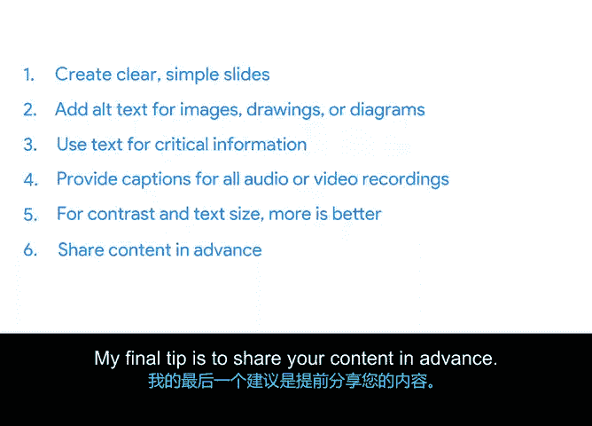

# 谷歌项目管理：专业证书 第4课：《项目执行：推动项目》｜project-execution-google｜ - P35：35_03_06_确保演示的可访问性.zh_en - GPT中英字幕课程资源 - BV1Eu4y1i7Zk

Hello， again。 You just learned a lot about presentation best practices from my colleague。

 just like you need to be strategic， prepared and clearer about which data you want to share。

 You also need to be intentional about ensuring your presentations are accessible and could be consumed and understood by everyone。

😊，Let's dive into some accessibility tips to set you up for success。

 starting with the design of your presentation。First， create clear， simple slides。

 Avoid using too many graphics， too much text or too much animation。

Visual complexity makes it harder for people to absorb information during your presentation。

 especially for those with a visual or cognitive impairment。If your slide use animation。

 make sure that you don't leave people behind by making important content disappear。

If people read more slowly or rely on an interpreter。

 they might need a bit more time to absorb the content。

Avoid using repetitive animation like flashing or flickering。

 since it can be distracting and con trigger seizures。Simple doesn't have to mean boring， though。

 A simple s can still be beautiful and informative。

Just don't try to crowd too much information or activity into a single slide。

If you generally don't use slides when giving a talk， consider giving it a try。

 Even if you create just one slide with the main points。If you rely only on your voice。

 that is you don't provide any visual accompaniment。

 some people might have difficulty understanding whether because of a language barrier or hearing or cognitive impairment。

 Another tip is to include alternative text， also called alt text for any images。

 drawings or diagrams。Doing so describes the information relatedlay in a graphic to make it accessible to people who rely on screen readers。

😊，To add alt text in Google Slides or PowerPoint， simply select the object， right click。

 and then select alt text。The same consideration applies to charts。

 Chars can be difficult to decipher， especially if they use a small font in order to fit more data。

If your slide includes data heavy charts or graphs， be sure to specify the takeaway。

 either on the slide itself or in the speaker notes。 Next， always use text for critical information。

 Never rely only on color or other visual formatting to convey critical information on a chart or slide。

Relying too heavily on visual formatting， it clued anyone one who is color blind or unable to see the screen。

For example， to highlight a new section of a flow chart， don't simply use a different color。

Along with the color change， add a textual cu， such as a word new。

If your presentation relies heavily on images， consider including a written summary at the end of the presentation so that people can read your main points easily in one place。

Another tip is to include captions for video content and in real time。

Provide captions for all audio or video recordings shared in your presentation。

If you're using a YouTube video， check that the YouTube automatic captioning is accurate。

 If it's not， request closed captioning through a captioning service。

Use real time captioning for your presentation， if available。

 along with helping deaf or hard of hearing audience members。

 real time captioning is useful If there are diverse accents and languages of the moon。

 if the presenter speaks too quickly。😊，If there are microphone issues or if you have chatty audience members who are distracting their neighbors。

 Another thing to remember is for contrast and text size， more is better。

 The difference between text and its background color is called contrast ratio。

A high contrast ratio makes it easier for people to read， text or decipher images。

 especially if they're sitting far away or have low vision or color blindness。

An ideal contrast ratio is 7 to1。There are contrast checker tools available online。

 so be sure to check those out。Recommendations for text size vary， but bigger is usually better。

Before your presentation begins， go to the back of the room and make sure you can read your slides。

 Also， the use of all capital letters makes reading text more difficult for some people。

 such as people with dysxia。When possible， avoid using all cves。

This is a simple change that can go a long way。My final tip is to share your content in advance。

If possible， send slides to your audience a few days before your presentation。

This gives the audience a chance to review the content and if needed。

 make arrangements to accommodate their own needs and preferences。For example。

 visually impaired audience members might want to follow along with your slides on their own device。

 with screen mut software。If you aren't able to share your slides in advance。

 consider sending a document with a bulleted outline of your presentation。

And if you're using acronyms or technical or obscure terminology。

 include a glossary with definitions。This information is especially helpful for sign language interpreters and captionists。

All of these best practices you just learned will help make your presentations accessible to all of your audience members。

Remember， you can't communicate information effectively if your audience can't easily access it。

For these and other best practices on how to make your documents and presentations more accessible。

 check out the resourcessources tab。Coming up， you will learn about team communication and best practices。

 So good work so far。 You're making real progress， and I'm excited to be a part of your journey。😊。

