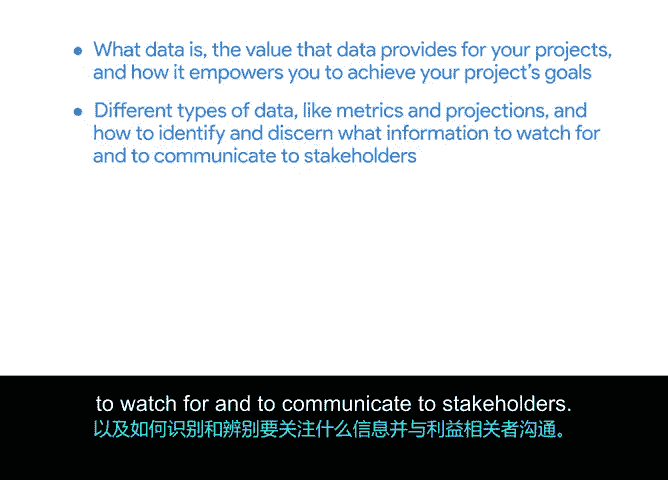

# 谷歌项目管理：专业证书 第4课：《项目执行：推动项目》｜project-execution-google｜ - P36：36_03_01_总结_3.zh_en - GPT中英字幕课程资源 - BV1Eu4y1i7Zk

Congrats on reaching the end of this module。 So what did we learn。

We learn that data plays a key part to the success of any organization and it impacts your role as a project manager。

We've learned what data is， the value that data provides for your projects。

 and how it empowers you to achieve your project goals。

You learned about the different types of data like metrics and projections and how to identify and discern what information to watch for and to communicate to stakeholders。

We also discussed how important data is to help you make informed decisions and showcase areas where you and your team are being most effective。

 flagging potential risks and opportunities to advance。

We reviewed data visualization and data tools and learned that facts are usually easier to remember when there's a visual alongside it。

We also discussed ways for you to present all of your insights to stakeholders。

 colleagues and customers， so let's pause so you can give yourself a high five for coming this far。

Next up， we'll discuss leadership and the fundamentals of teamwork。

 keep up the great work and we'll meet you there when you're ready。

