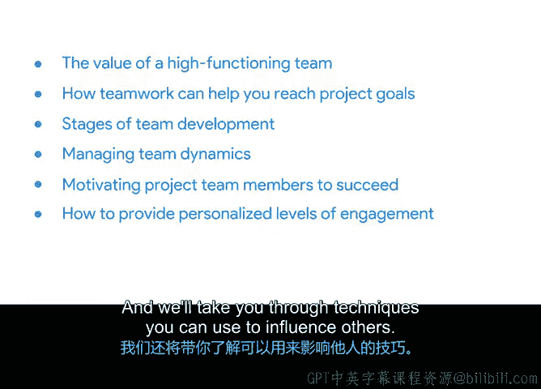

# 谷歌项目管理：专业证书 第4课：《项目执行：推动项目》｜project-execution-google｜ - P37：37_04_01_领导力与影响力技巧介绍.zh_en - GPT中英字幕课程资源 - BV1Eu4y1i7Zk

Welcome back in this module， you'll learn the value of a high functioning team and how teamwork can help you reach your project goals。

We'll also take you through the different stages of team development and you'll learn about managing team dynamics。

We'll discuss motivating project team members to succeed and providing each person with personalized levels of engagement。

And we'll take you through techniques you can use to influence others。

Let's get started。

