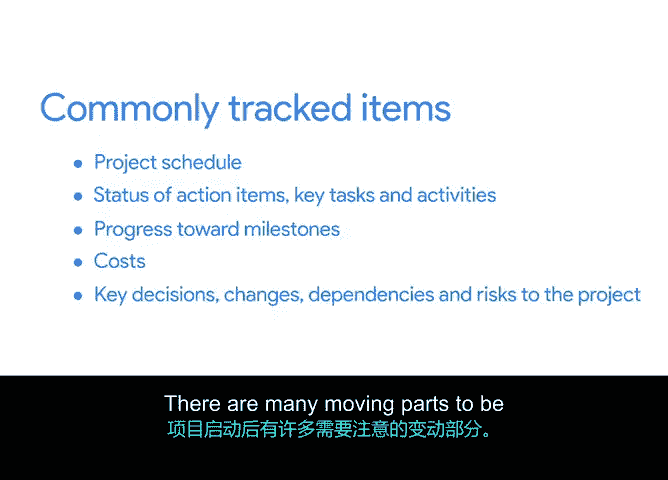

# 谷歌项目管理：专业证书 第4课：《项目执行：推动项目》｜project-execution-google｜ - P3：03_01_02_常见跟踪项.zh_en - GPT中英字幕课程资源 - BV1Eu4y1i7Zk

So we've discussed that tracking monitors the progress of project activities。

 but you may still be wondering， what specifically should you be tracking。

I'll take you through a few of the most commonly tracked items that I found helpful when managing projects at Google。

First， you should always track the project's schedule。

 This is made up of tasks and activities that ensure that the project is effectively heading toward its completion date。

 After all， your ultimate goal is to complete your deliverables on time。

Equally important is tracking the status of action items。

 key tasks and activities to ensure that that work is actually getting done。

 Tracking tasks also helps to track your team's progress toward milestones。

 We learned a bit more about tracking progress toward milestones earlier in the course。

 And we stress the importance of creating tasks and milestones to keep everyone on track。😊。

When you're in the middle of a project， new tasks will come up all the time。

 In order to avoid missing deadlines。 It's imperative to track tasks as they progress。

 And as you approach key milestones。 Next， you'll also need to track costs to ensure that you don't overspend or underspend on project tasks。

 As I mentioned earlier， all projects have budgets and whether or not your overseeing the entire budget。

 you may be overseeing tasks and resources that have budget implications。 And finally。

 you'll need to track key decisions， changes， dependencies and risks to the project。

 including any agreed upon scope changes。 This way。

 your team and stakeholders are aligned on what needs to be done for the project to succeed。

 We will cover this in more detail throughout the course。

 since it's a big part of running the project。😊，To recap the items that are helpful to track throughout the project execution phase include the project schedule。

 which contain the key tasks and activities， the status of action items。 progress toward milestones。

 costs and key decisions and changes。 There are many moving parts to be aware of once a project is underway。

 Traing them closely benefits you and your team as you head toward the project goal。

 I've taken you through an introduction to tracking and coming up。

 We'll discuss project management tools and templates you can use to track project activities。

 Me me in the next video to expand your toolkit。😊。

