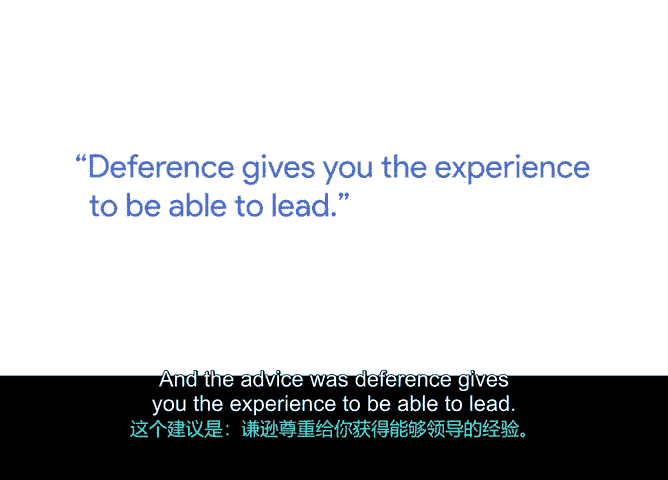

# 谷歌项目管理：专业证书 第4课：《项目执行：推动项目》｜project-execution-google｜ - P41：41_04_03_Emilio-学习领导.zh_en - GPT中英字幕课程资源 - BV1Eu4y1i7Zk

I am from Orange County， California。 My mom was a school teachereach for the majority of my life。

 She also went on to be an assistant principal and then became a principal herself during that entire time as a kid growing up。

 I never had my summers。 I actually ended up spending all of my time with my mom at her school。

 helping her with teachers who wanted to restock their shelves or file away papers or shred papers。

 some important advice that my mother told me when I was growing up。

 especially when I would go spend time with her in her schools and saw what her leadership style looked like she had and still has this uncanny ability to connect with people and ways that not only make them feel seen but feel empowered and I think that's a very powerful leadership style。

 and it's something that I like to bring to my project management role as well。

 because it allows me to make sure that people feel like they can get things done。

 but it's not just for me。 it's for a collective vision。And the advice was。

 deference gives you the experience to be able to lead。

 And it's important because as a project manager， as we've said in these courses。

You're not going to know or you're not going to have a lot of the technical or specific domain expertise that you need in order to create the big。

 meaty things that you're trying to drive。 But as a programme or a project manager。

 you're kind of the leader who's supposed to be making sure things get done。

 And you work with every little piece of the pie。 So like my mom， who was a principal。

 worked with the custodial staff， she worked with the P T A。

 She worked with the teachers and the teachers union， She worked with the parents。

 and she developed this great。Network of people that helped her get things done。

 So I would say that was the best advice that I've received。 My name is Emilio Garcia。

 and I am a responsible innovation program manager at Google。

