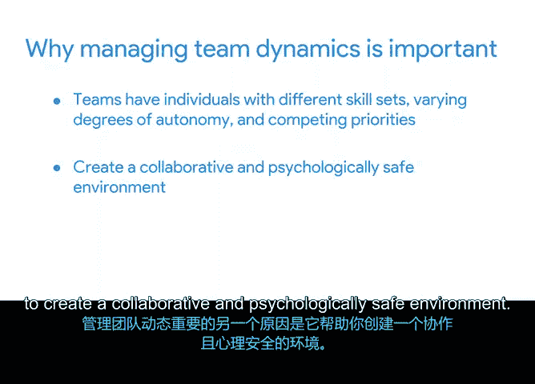

# 谷歌项目管理：专业证书 第4课：《项目执行：推动项目》｜project-execution-google｜ - P42：42_04_04_团队发展与团队动态管理.zh_en - GPT中英字幕课程资源 - BV1Eu4y1i7Zk

Imagine that you're starting a new project with a brand new team of people。

 No one on the team has worked together before。 So this will be a new experience for everyone。😊。

To better understand how your team might develop over time。

 let's discuss the psychologist Bruce Tuckman's five stages of team development。Forming， storming。

 norming， performing and adjoining。These stages of development illustrate how teams grow from a disparate group of people into a high functioning unit。

You might even recognize the characteristics of each stage from previous experiences working on a team。

 Tuckman's first stage of team development is the forming stage。At this point。

 everything feels shiny and new。 Individuals on the team are just getting to know one another。

 and they're eager to make a good impression。And typically。

 they're excited for the work to begin during this stage， you， as the project manager。

 should clarify project goals， roles and context about the project。 People are seeking guidance。

 and it's your job to provide that guidance。 The second stage of team development is the storming stage。

 This is where things get a bit trickier。 as people settle into their roles and the work on the project begins。

 The people on your team are interacting more and may be disagreeing a bit。

 This is where feelings of frustration might emerge。😊。

Individuals might take issues with certain processes they feel are inefficient or other teammates they disagree with。

 especially when the team is navigating tasks that are much more complex than they first appeared。

 Make sense， right。If you're working closely with a new group of people for the first time。

 there's bound to be some interpersonal conflict。Teammates might disagree on time and effort estimations。

 vary in their levels of independence or prefer to prioritize certain tasks over other equally important tasks。

 As the project manager， it's your job to focus on conflict resolution。

 Listen as the team addresses problems to solve and share insights on how the team might better function as a unit。

After stormming comes tuuckman's third stage。 the norming stage。 At this point。

 the team has resolved some of its internal conflict by establishing new norms。

 like processes and workflows that make it easier for everyone to get things done。

The team feels better equipped to work together efficiently and effectively。 You。

 as the project manager， should codify the team norms。

 En that the team is aware of those norms and reinforce them when needed。 For example。

 if you've agreed to discuss solutions to issues during weekly team meetings。

 ensure that your weekly agenda， budget it's time for this topic。 each week。

 Tuckman's fourth stage is the performing stage。 During this time。

 the team works together relatively seamlessly to complete tasks。

 reach milestones and make progress toward the project goal。In the performing stage， you。

 as the project manager， should focus on delegating。

 motivating and providing feedback to keep up the team's momentum。

 The fifth and final stage of team development is the adjoording stage。 In this stage。

 the project is wrapping up， and it's time for the team to disband。

It can be a bittersweet time for the team， and you might want to mark the end of the project with a celebration。

You， as the project manager， should set up time to celebrate the final milestones and success of the project as a group。

 and be sure each member of your team knows what's next for them。Okay， to recap。

 Tuckman's five stages of team development are forming， storming， norming， performing， and adjoing。

These stages of team development come together to form a helpful framework you can use to assess and recognize team dynamics and then adjust your management style accordingly。

Team dynamics refer to the forces， both conscious and unconscious。

 that impact team behavior and performance。Managing team dynamics is a big part of determining how to motivate your team。

 It might be tempting to assume that people can go full speed ahead into a project。 but in reality。

 it's important to take time to understand the dynamics of your team overall and how individual team members are fitting in。

This is especially important during the more precarious forming and storming stagess。

Let's break down why managing team dynamics is so important。 First。

 teams have individuals with different skill sets， varying degrees of autonomy and competing priorities。

It's your job to forge consensuss and set clear purposes， goals， dependencies and accountability。

When teams function cohesively， they can focus on the tasks and objectives at hand。

 Another reason why it's important to manage team dynamics is that it helps you to create a collaborative and psychologically safe environment。

When team members feel safe， they're willing to help one another and accept help when they need it。

This benefits the entire project by keeping schedules on track。

 though it can take time to get to the performing stage。

 using the norming stage as a time to foster a collaborative environment can help you get there quicker。

Understanding and managing team dynamics can also help you understand how to motivate your team。

 Motivated team members are likely to contribute more to discussions。

 Complete their tasks and actively participate in other project activities。

 A positive team atmosphere can help employees feel empowered。

 more comfortable taking calculated risks and more likely to seek out innovative solutions to complex problems。

 Remember， so much of team dynamics happens under the surface。

 identifyingdentifying and understanding the stages of team development can help you make sense of how dynamics are playing out on your team。

😊，This can help you to be a better leader。Coming up。

 we'll discuss what it means to promote ethical and inclusive leadership in the workplace。

 Meet you there。