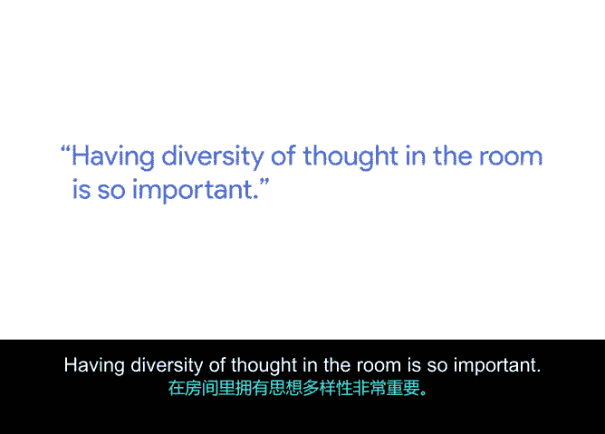
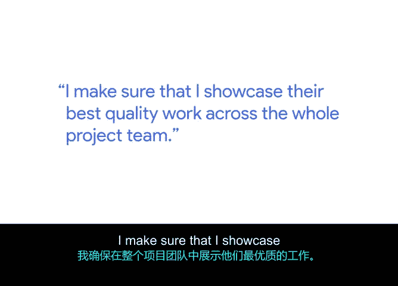

# 谷歌项目管理：专业证书 第4课：《项目执行：推动项目》｜project-execution-google｜ - P43：43_04_05_Rowena-细节委派.zh_en - GPT中英字幕课程资源 - BV1Eu4y1i7Zk

Hi， I'm Roena， a senior programme manager in the systems productivity and reporting team in Google Cloud As a project manager。

 you'll find that you're not actually the direct manager of people in their roles。

 The key soft skill to have here is around influence， Influencing without authority。

It's the ability to be able to communicate with people and make sure that they understand your goals and objectives and take them along on a shared vision and shared journey。

 So when I first became a project manager， one of the mistakes that I often made was trying to do everything for myself。

And not asking for help over the course of the last couple of years。

 I've really learned how to delegate and work with others as part of a team to make sure that I am effectively managing a project as a project manager regardless of whether I have management or authority over the project team and allowing those SMEs to really do what they're really good at delegating for me in my day to day role kind of looks like this。

 so I try to find subject matter experts or people that really enjoy doing a specific something that may not actually be their role。

One of the best pieces of advice I ever got from a mentor was around finding people in the organization that enjoy doing something and delegating your work to them that way。

 you can focus on overall project or program management without having to get bogged down in the weeds by certain details that actually you might not enjoy doing or someone else really enjoys doing P psychologicalychological safety is really important in teams because it brings diversity of thought to the table。

😊，One thing that I'm really working on is making sure that we practice inclusive meetings。

An example of that could be in a meeting， if you notice that one or two participants are usually quiet or don't speak up。

 try to encourage them to be a part of the conversation Even better。

 have a coffee with them before and ask them what they think of that upcoming topic。

 Enage them to bring those ideas to the table。Having diversity of thought in the room is so important。

 Otherwise， you're going to end up with one person in the room constantly just bringing their thoughts and ideas to the table。

 That's not very diverse。 So one thing with psychological safety is。

This kind of partnership with mentorship and sponsorship。So to delegate。

 I make sure that I sponsor people， so I make sure that I showcase their best quality work across the whole project team It's really important for morale。

On the other side， with mentorship， if there's a junior team member on the team that maybe doesn't have the experience or isn't as confidence speaking up。

 I usually delegate smaller tasks to them to build up their confidence or delegate something that they might actually consider to be fun that's not in their normal day to day work。

 So finding those kind of unique balances is the best way to delegate and prioritize。

