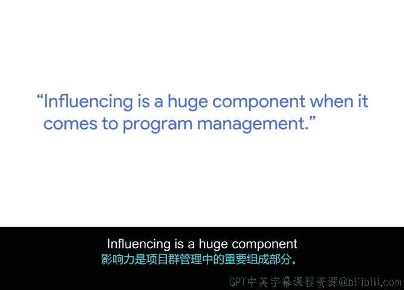
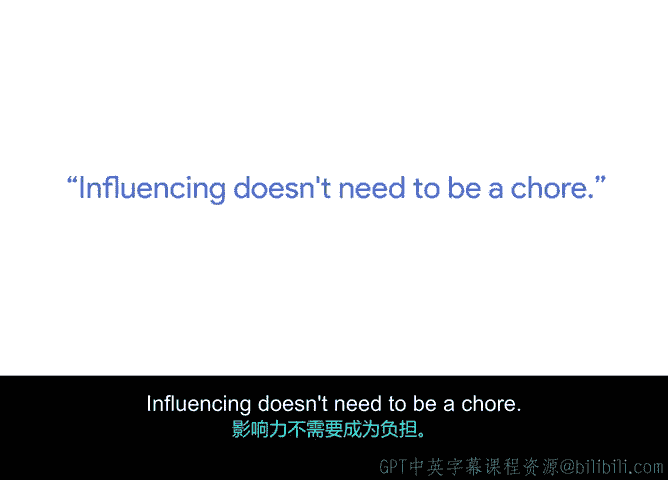

# 谷歌项目管理：专业证书 第4课：《项目执行：推动项目》｜project-execution-google｜ - P47：47_04_03_Chris-通过展示项目影响力影响他人.zh_en - GPT中英字幕课程资源 - BV1Eu4y1i7Zk

Hi， I'm Chris。 I'm a diversity program manager here at Google。

 Influencing is a huge component when it comes to program management。 You might have。

An incredible idea about where you want a program or a project to go。

 And so once you have come up with all these creative ideas and you want to convince someone to sign off on it。

 you have to think about what's in it for them。 What's the impact that this project or program is going to have on the business on the consumer。

 What have you。 And so once you're able to distill what that impact is going to be。

You can really think about how you're going to frame the ask to that executive stakeholder， right。

 So influencing everyone has the ability to do it。 you've done it since you were a kid。

 whether it be trying to go out and play with your friends or get your favorite meal from the favorite restaurant that you have。

 You've always tried to influence someone to give you what you want。

 But you have to think about what the value is for them。 So different when you're a kid。

 the value is only really for you。 when I first came into my role as a diversity program manager。

 there were a set of programs that had been around for a number of years。

 and I came in had a fresh set of eyes， and I recognized that there's a lot of redundancy with the programs that we had what I did is it came in and I had to influence people that had been running those programs that they programs where all very similar。

 and that if we all worked together， we'd be able to build just one programs that solves all these needs。

 Now that took some time， right I had to。Show examples of why I think this Sing program could。Impact。

The target population the same way I had to show how each person would have a role in this new found program。

 right， I， I couldn't just say， like all of your programs need to stop It was more so all your programs need to mature into this new this new identity。

 So it took some time。 it really， it also took a lot of relationship Maaging and and and immuring because I was a new guy。

 So I had to come in and prove myself。 as the impact was shown pretty soon after because it was thought through well in advance。

 My advice is keep it simple。So you have all of the background information about why this is important。

 all the steps that'll take to get there。But the person who you're trying to influence just needs to know。

When you're gonna get there and basic information on how you're gonna to get there。

 And so don't try to bring them into the weeds with you。

 Keep them at a point that makes sense for the audience that you're in。

 So if you talking to a researcher， they might want to know the data points。

 So they're talking to the the marketing team。 They want to probably know the the more splashy high levell elements and the target demographics。

 right， So keep in mind your audience， but keep it simple。 Influencing doesn't need to be a chore。

Once you've done the work， you should be excited to talk to someone about it。

 And so if you don't feel excited about the work that you're doing。

 I would take a step back and think about what it is that you are building。

 what it is that you're putting together。 and if it doesn't excite you。

 it's not going to excite somebody else。