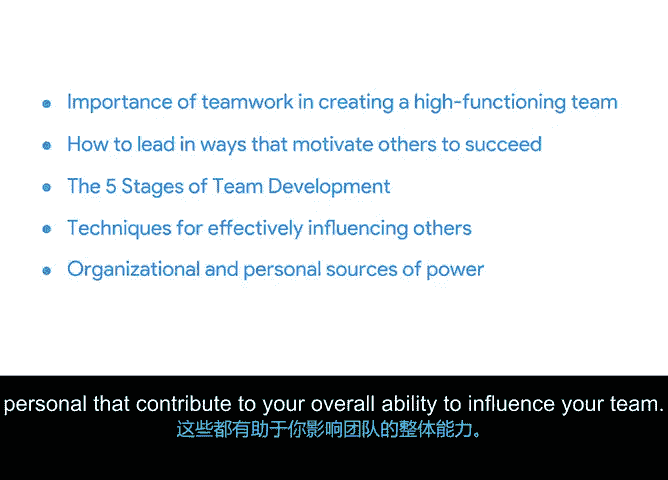

# 谷歌项目管理：专业证书 第4课：《项目执行：推动项目》｜project-execution-google｜ - P48：48_04_01_总结_4.zh_en - GPT中英字幕课程资源 - BV1Eu4y1i7Zk

Nice work。 You made it to the end of this module。 How are you feeling。Over the past few videos。

 I've taken you through the many facets of team management and influencing。

You learn to explain the importance of teamwork in creating a high functioning team that can complete the work of a project on time。

And you learn how to lead in ways that motivate others to succeed。

 both at the team level and on an individual level， too。

You learned about the five stages of team development。

 which is a helpful framework for understanding and managing sometimes challenging team dynamics。

I explained how to apply techniques for effectively influencing the people around you。

 and you learn what not to do when trying to influence others。And finally。

 you learned about the sources of power， both organizational and personal that contribute to your overall ability to influence your team。

😊。

Coming up， I'll take you through effective project communication。 See you soon。

