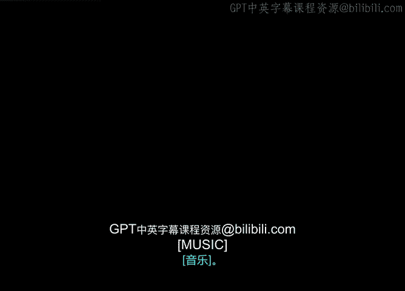
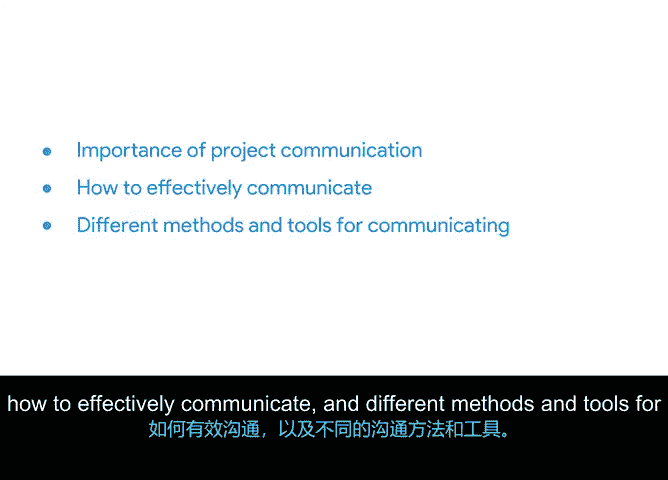

# 谷歌项目管理：专业证书 第4课：《项目执行：推动项目》｜project-execution-google｜ - P49：49_05_01_高效项目沟通介绍.zh_en - GPT中英字幕课程资源 - BV1Eu4y1i7Zk

Hi and welcome back in the last section， you learned all about team management。

 the stages of team development， how to motivate team members and setting expectations for your team。

🎼One thing that is incredibly important to teamwork and managing projects is strong communication Over the next few videos。

 we'll discuss the importance of project communication。

 how to effectively communicate and different methods and tools for communicating Read Let's get to it。

