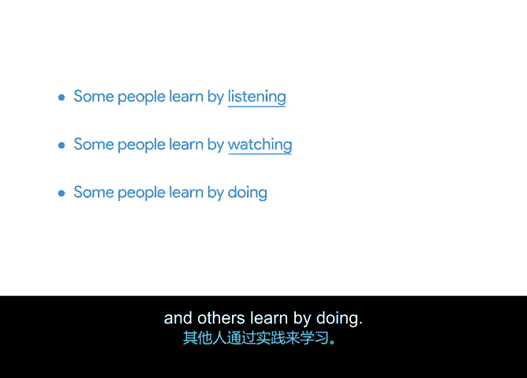

# 谷歌项目管理：专业证书 第4课：《项目执行：推动项目》｜project-execution-google｜ - P50：50_05_02_多样化沟通方式.zh_en - GPT中英字幕课程资源 - BV1Eu4y1i7Zk

By now， you should be aware that effective team communication is necessary to help ensure a successful project outcome。

In this video， I'll share more tips for communicating with your team and introduce you to tools that will help you and your team communicate even more effectively。

 As the project manager， you are the one who connects your team to the information they need throughout the project。

 you'll serve as the main resource for your team when it comes to communicating and clarifying goals。

 action items， progress and updates。 It's important to make sure that your're carrying information forward consistently and coherently so that everyone understands what the current state of the project is and what happens next。

😊，Teams communicate in a myriad of ways， though project managers are constantly communicating through check ins and meetings。

 project documents such as project plans， including schedules， trackers or meeting notes。

 There are also hubs for team communication。It's your responsibility to be clear about how those documents get used。

 who has access to those documents， and how often the documents get updated。Of course。

 in addition to those responsibilities， you'll also have to field emails。

 instant messages and attend meetings。 All of these things are critical in driving a project forward As a project manager。

 you are the one who coordinates incoming and outgoing information。

 You connect individuals to the necessary details and context。😊。

And track who needs to receive what information and when you'll need to communicate certain information to your team multiple times and in various ways。

Some people learn by listening， some people learn by watching， and others learn by doing。

Communicating in various ways ensures that you're sharing knowledge to your team in a format that's digestible and easy for them to take in。

Your team will have a lot of tasks to focus on。Be proactive and reinforce important information multiple times in multiple ways so that no one is left out of the loop。

 There are many tools for communicating with your team to make it easy to keep in contact and be on the same page throughout the duration of the project。

 Some of these include email and messaging。In person meetings。

 video conferencing and work management and collaboration tools。

 your organization might have some of these tools in place already。

 or you might have the opportunity to select some for a project。In either case。

 it's good to be familiar with what's out there。 We'll explore tools that provide effective project team communication in more detail in the next video。

😊，Meet you there。