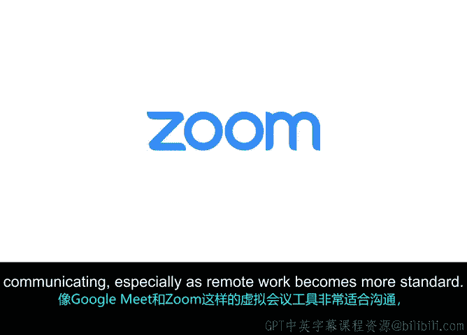

# 谷歌项目管理：专业证书 第4课：《项目执行：推动项目》｜project-execution-google｜ - P51：51_05_04_常用沟通工具.zh_en - GPT中英字幕课程资源 - BV1Eu4y1i7Zk

Hi again。 Let's explore some of the common tools for effectively communicating with your project team and stakeholders。

 In this video， we'll focus on messaging， virtual meetings and work management and collaboration tools。

😊，Let's start with messaging and email。 Email is standard for business communications。

 So it's important to streamline the number of emails that you send out at Google。

 I get tons of emails a day。 It's a lot of work to figure out which ones I need to read immediately。

 Which ones can wait and which ones require a reply right away。

It's important that you understand how to use email in a professional context。

 A quick internet search will provide you with lots of tips and examples。

 Here are some of my key tips for you to keep in mind。

 Carefully select who you're sending an email to。 and most importantly。

 be conscious of why you're sending it。Make sure the subject field clearly statess what the email is about。

If it's urgent or requires a response， add that to the subject and the first line of the email。😡。

Keep your messages as short as possible and stay on topic。If there's a lot of information to share。

 consider placing the information into a digital document you can link or attach to the email。

Then summarize what you want readers to focus on if there's a specific action you need from the recipient。

 State it clearly so that they understand what's expected of them and when。

Your language choices matter， so avoid slang， acronyms and shortcuts for words that might be more appropriate for text。

Oh， and one more thing。 write in an appropriate tone for the person receiving the email。

 It's generally best practice to be friendly， motivating， clear and specific， As I mentioned earlier。

 Most people， especially other managers， directors and executive， get lots of emails。

 With that in mind， you may want to consider instant messaging tools like Google Me or Slack。

 This can be an alternative to email when you just have a quick question or update。

 or as a way to alert someone to please check their inbox。 Ins messaging。

 helps reduce back and forth emails or phone calls and can quickly clear up miscommunications。

 or let you know if and when you should take an issue to a meeting。😊。

Be mindful of when you decide to use instant messaging。

 this kind of quick communication can lead to distraction and informality。

It can easily become an outlet to share non work related information or information that's sensitive or confidential。

It can also be difficult to track instant messages。 Later on。

 if you need to reference information that you chatted about。

 you might not be able to easily find it with instant messaging。

It's a good idea to ask people's preferences on how they like to be communicated with。

Even if instant messaging is faster， the person might prefer to use email with experience。

 you will be able to determine the most effective ways to communicate with your team。 Next up。

 we'll discuss some tools for remote meetings。Virtual meeting tools like Google Meet and Zoom are great for communicating。

 especially as remote work becomes more standard。 better yet。

 each of these tools are easy to access and easy to learn how to use。 Well run。

 online meetings can be extremely effective。 They allow you and your team to interact in real time。

 which can help boost Morrell and create a sense of team when it's not possible to be together in person。

 Virtual meetings can be highly engaging as attendees can access and share files during the meeting。

😊。

And then there are work management and collaboration tools like Google Drive， Asana， and Smartheet。

These kinds of tools make it easier to share information among teams even better with work management and collaboration tools。

 information sharing goes both ways。 Tea members can easily update their progress without the need for extra meetings or phone calls。

 These tools can accomplish many different things like tracking progress on tasks。

 deliverables and milestones。 They can also help you to manage a budget。

 build helpful charts and diagrams， manage contracts and licenses and keep stakeholders informed。😊。

Work management and collaboration tools allow you to focus your communications within the context of specific tasks。

 project details and timelines， rather than writing an email and linking to the relevant information when you're working and communicating in a tool。

 the information is already there in one place for easy reference and decision making。😊。

Another great aspect of these kinds of tools is that the work gets done in real time。

These tools allow remote teams to collaborate and communicate as though they're physically working in the same office together。

Encouraging your teams to check in and update their progress regularly helps to maintain the real time feel of interacting with coworkers。

 There are many different types of work management software that automatically make project planning and tracking a lot easier。

 and they are much more efficient than manual project tracking。

 A quick word of caution before we move on。 The use。

 access or sharing of confidential or need to know information externally。

 including financial and business data， Use data and information about our products and services is likely prohibited。

 unless you're given explicit permission。😊，When using shared work management tools。

 just be mindful of who wants and needs access versus who doesn't need access to do your part in keeping important data safe。

 There are so many different ways to share information to your team， whether through meetings。

 emails， instant messages， spreadsheets and trackers by becoming familiar with some of the more common communication tools。

 you can choose the right one for your project needs。Now。

 you've learned a bit more about the importance of team communication and some tools that effectively communicate and foster collaboration within your team。

 In the next video， we'll learn how to organize and facilitate team meetings to ensure project success。

😊，I'll meet you there。