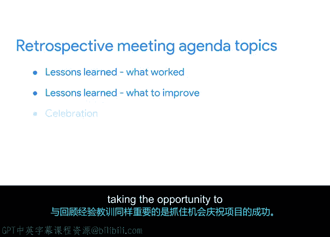

# 谷歌项目管理：专业证书 第4课：《项目执行：推动项目》｜project-execution-google｜ - P53：53_05_04_常见项目会议类型.zh_en - GPT中英字幕课程资源 - BV1Eu4y1i7Zk

Hi again。 Now that you've learned the key components for organizing and facilitating an effective team meeting will explore the specifics of some of the most common types of meetings you'll need to have during a project。

 Every project has meetings。 Lots of meetings。 While every meeting is unique。

 being familiar with the most common types of project management meetings will help you better identify the goals。

 structure and activities best suited for each one。

 There are four general types of project management meetings。😊，Project kickoff， status updates。

 stakeholder reviews and project reviews。The first one we'll talk about is the project kickoff meeting。

This is often considered the official beginning of a project and serves as a way to align the team's understanding of the project goals with actual plans and procedures。

 Member of your team are the major attendees of your kickoff meetings。

 But the participation of senior management and key stakeholders is also required for securing buy in and ensuringuring alignment with project goals。

 The next type of meeting willll discuss are status update meetings。

 Sta update meetings are one of the most common types of meetings。

 This category includes regular team meetings where the primary goal is to align the team on updates。

 progress， challenges and next steps During the meeting。

 the project manager may distribute or present project performance reports and formal status updates on key elements of the project。

This allows the team and stakeholders to gain visibility into current performance levels and task progress。

 One of the project manager's key responsibilities is to be aware of the status of the project at any given time and to ensure that others are up to speed or nowhere where to find the latest information。

In order to do that， status updates become a critical tool throughout the life cycle of a project to check in on the project。

 Typically， you'll assess the status of each of the following topics during this meeting。 First。

 are task updates。It is important for the attendees to know what is the status of the most urgent tasks。

How many tasks have been completed and how many open items remain。Next is schedule status。

 Are we behind schedule ahead of schedule or on pace with our projections。Similarly。

 it's common to discuss the budget status and any new items that impact your bottom line。

Then you should discuss current or anticipated issues。 For example， changes， risks， resource issues。

 vendor issues and so on。Particularly changes to quality and scope。

 It's always a good idea to raise these items on a recurring basis so that no one is caught off guard and you can discuss solutions together。

 Lastly， you'll want to discuss action items。 An action item is a task on your list that needs to be completed。

 assignsigning action items is a great way to wrap up the meeting and make sure the project keeps forging ahead。

Remember， every action item has an owner and a due date。

The status meeting is a fundamental project tool that keeps the project on track。

Most project managers recommend using a relatively fixed agenda and time with this meeting。

To keep the team engaged， follow the agenda and hold the meeting to a tight schedule。

Because the project manager should be able to report up to date information to the project sponsors or clients at any time。

 it's important to conduct status meetings regularly。

 Status meetings are beneficial because they provide an opportunity for recognizing milestones。

 sharing information and raising concerns to the team。

How often you decide to schedule these meetings depends on several factors。

 such as the project's complexity， number of team members。

 and the level of information required by the project sponsor， clients， or others。

Don't be afraid to change up the cadence as your project progresses。

Another type of project management meeting is a stakeholder meeting。

 Stholder engagement is essential for successful project management。😊。

The goal of a stakeholder meeting is to get buy end and support。

 stakeholdersholders each have their own set of tools， know how and expertise。

Stakeholder meetings are where these contributions are outlined and utilized。

 You'll need to start by understanding a stakeholderss challenges or problems。

 then respond accordingly and make necessary adjustments to resolve those challenges。

Winning and sustaining the support of your stakeholders is important to your project's success。

In some cases， you might want to have stakeholder meetings on a one on one basis。

This allows you to dive deeper on relevant details with each stakeholder。

 Then you can cover the topics that are most interesting and concerning to that particular person。

 Other times， you'll need to engage stakeholders in groups。

If you have a large number of stakeholders to manage。

 focus the meeting on your project's most influential stakeholders。

 identifydentify appropriate stakeholders for high touch communication。 For example。

 you may focus the meeting on senior managers from each of the groups you need to engage。

Other stakeholders can be informed using other methods， such as email or meeting notes。

 While there are a number of potential topics to cover when meeting with stakeholders。

 most meetings are limited to communicating critical information。

 You should always be able to present a project update。

Start the meeting with a short overall project status update of two to five minutes。

Another key reason to meet with stakeholders is to seek out and listen to feedback。

Or you might meet with stakeholders to make a decision or resolve a major issue surrounding your project。

In this case， you'll often meet with senior leaders and the project sponsor Decions could include go or no go decisions。

 a choice between options or signing off on investments。 Stholder meetings are generally more formal。

It's normal to prepare reading materials and documents to review ahead of time to help get people in the right mindset for the meeting。

Stakeholder meetings can be regular and recruiting or just a one off project meeting。

The frequency will depend on why the stakeholder is involved in the project。

 are they playing an advisory role such as a consultant and a racy or just someone to inform and keep in the loop。

Does their involvement set around just one activity on the project or do they need to stay involved on a longer term basis？

You'll need to decide on a case by case basis。 The end of the project or the end of the project phase is an excellent opportunity to review how the project unfolded。

 This is called a retrospective， and you'll learn more about this in other sections of this course。

 A typical retrospective meeting agenda includes reviewing lessons learned about what's going well。

 what you should keep doing and what can be improved。

Equally important to reviewing lessons learned is taking the opportunity to celebrate the project success。

 Knowing the difference between these project meeting types allows you to maximize productivity and ensure that you're not wasting time。

😊。

You'll get the right outcome from each type of meeting。

 which will help drive decisions and lead to proactive， positive actions。Amazing。

 you just learned about the common types of project meetings and how to make them effective for everyone in the room。

😊，In the next video， we'll recap what you've learned in the past few videos。 I'll meet you there。

