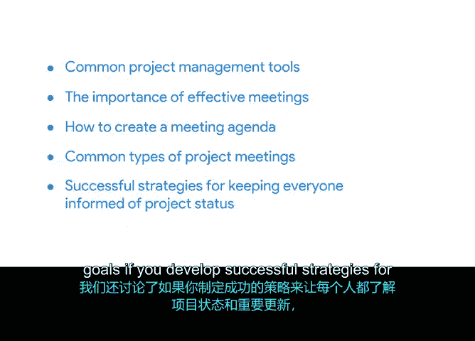

# 谷歌项目管理：专业证书 第4课：《项目执行：推动项目》｜project-execution-google｜ - P54：54_05_01_总结_5.zh_en - GPT中英字幕课程资源 - BV1Eu4y1i7Zk

Welcome back。 In this section。 You learned about some common project management tools that are helpful for communicating with your team。

 You also learned about the importance of effective meetings。

 how to create a meeting agenda and the common types of meetings that you'll organize and facilitate as a project manager。

 And we discussed how you can increase your chances of achieving a project's goals。

 If you develop successful strategies for keeping everyone informed about the project status and major updates。

😊。

Kos， you've completed this module。 Nice job Coming up。

 you'll learn all about the final phase of project management， closing the project。😊。

