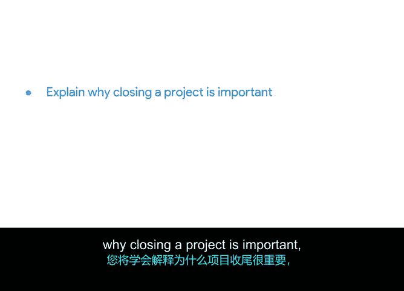

# 谷歌项目管理：专业证书 第4课：《项目执行：推动项目》｜project-execution-google｜ - P55：55_06_01_项目收尾介绍.zh_en - GPT中英字幕课程资源 - BV1Eu4y1i7Zk

Welcome to a new module here we'll be learning about how to close a project in this set of videos you'll learn to explain why closing a project is important。

 determine when a project is complete and outline the project closing process。

We'll learn that closing serves as an integral aspect of the project and helps avoid unfavorable scenarios。

 we'll also learn that completing a project and closing a project are two very different things。

We'll talk about how your stakeholders and clients fit into the closing process。

 We'll cover how your team can help you close a project and how you can use retrospective meetings to improve your procedures and processes。

We've touched on retrospectives a bit in the previous module。

 but you'll learn about them here in a new context。

You'll also learn that a project isn't fully closed until you celebrated your team for a job well done。

Then we'll explore how the closing process works， specifically for you as a project manager。

🎼We'll learn what kinds of presentations and documentation are required for project managers to properly close the project。

There's a lot to cover。So let's start with an overview of the closing process。

Meet me in the next video。