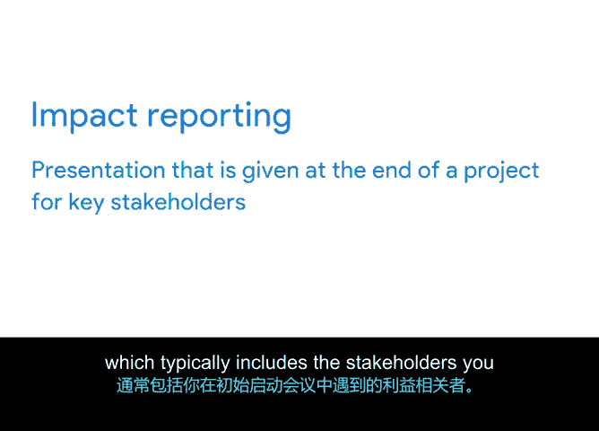

# 谷歌项目管理：专业证书 第4课：《项目执行：推动项目》｜project-execution-google｜ - P57：57_06_01_面向客户与利益相关者的收尾流程.zh_en - GPT中英字幕课程资源 - BV1Eu4y1i7Zk

In the last video， we talked about why the closing process is important in general。

 and we'll get more specific in this video as we discuss why closing is important for clients and stakeholders。

A formal closing process is important not only because improper closing may leave you on the hook for incomplete contracts or incomplete scope。

 but also because you want stakeholders to feel like their needs were met。As we mentioned earlier。

 a project team's relationship with customers， Use， vendors and so on can be impacted by loose ends。

 If relationships are impacted negatively， your team's credibility may be impacted。 Typically。

 stakeholders set the goals and scope of the project alongside the project manager。

 So a good project manager will always want to make sure those stakeholders are satisfied with the quality of deliverables and the end product。

 too。So how can you make sure that clients and key stakeholders are happy with the project closing？

First， you'll want to decide if your project warrants a small closing process at the end of each milestone or a formal and more comprehensive closing phase near the very end。

 You may even decide to do both a small closing process at the end of each milestone and a more formal closing phase at the very end。

You'll determine this by asking yourself if a particular milestone is final。

 meaning the milestone will not need to be readaddressed at a later time in the project。If so。

 having a short formal closeout will ensure that everyone is clear on the outcomes of that particular milestone。

For example， let's put this in the context of the Project Plant Pals website launch。

Launching the website is an official milestone， so having a formal close out to the website launch might make sense。

Yes， there will still be ongoing updates and maintenance to the site， but it won't be launched again。

 so the launch is a one time event。So you need to make sure you're handing over deliverables。

 putting together the proper documentation and alerting all stakeholders that you've reached that milestone and that that portion of the project is now closed。

 If you decide to conduct closing processes after each phase or milestone。

 here's what that will look like for your team。First。

 you'll ensure that the project has satisfied the strategic goals that it was intended to meet。

To begin， you'll want to refer to prior documentation such as your statement of work。

 request for proposal， risk register， and Racy chart。

You'll recall that these documents were discussed in previous sections。

 so feel free to revisit those as a refresher。While doing so， ask yourself。

 was all of the required work in the eapse phase done were all identified issues addressed？

Did every team member complete their assigned tasks？

Then you'll put together closing documentation such as creating closeout reports。

 which we'll cover in depth later。You'll build and review that documentation with team members to make sure that every aspect of the project has been discussed。

You'll also review notes from any retrospectives you and your team participated in。This way。

 your team members will get a chance to speak about the aspects they liked or didn't like。

 and they'll leave with a sense of closure。Next， you'll conduct administrative closure of the procurement process。

 close any contracts necessary， deliver the payments to vendors and retrieve all final deliverables from contracted workers。

This is really important so that external stakeholders and contracted workers can understand that the phase or the project is officially over。

 Then you'll want to formally recognize the completion of the phase， if necessary。

Make sure all stakeholders are aware that a phase or project is ending。

This may be as simple as sending out an email， notifying them that you've achieved this milestone or may warrant a larger meeting。

 Finally， you'll complete any necessary follow up work。

 This includes things like gathering final feedback and conducting closing surveys。 This way。

 you'll proactively help stakeholders with future issues by following up and offering support。

If instead of closing after certain phases or milestones。

 you've decided to close at the very end of your project， your process may be a little bit different。

Here's what that might look like。 First， provide the necessary training， tools。

 documentation and capabilities to use your product。

This includes things like manuals and how to guides。

 which give your customers and users an understanding of how to use your product or service after the project is closed。

 Next， ensure that the project has satisfied its goals and desired outcomes。

 Review the project to make sure that all tasks and deliverables were completed and nothing is missing。

Did you accomplish what you set out to do is the full scope of work completed。

 you'll also want to document acceptance from all stakeholders like clients and sponsors。

Ensuring that you have written proof that stakeholders are happy with the deliverables and outcomes is very important。

 This could be in retrospectives， a project completion document or any other formal sign off。

Then review all contracts and documentation with your project team。 This includes things like your S。

 O W， RFP， Racy chart， risk register and the procurement documents that we discussed earlier。

 including your whole team in this review process will help you make sure that nothing is missed。

 Always document your lessons learned by conducting a formal retrospective。

 including your team any other teams involved。 Your stakeholders and outside vendors in this meeting。

 We'll go over this in more detail in the next video。Finally。

 you can disband and thank the project team。The next important step in closing a project for the stakeholders is impact reporting。

 Impact reporting is a presentation that's given at the end of a project for key stakeholders。

 which typically includes the stakeholders you had in the initial kickoff meeting。

The purpose of impact reporting is to demonstrate how the project went and discuss the impact of your product or service。

It's important for the project manager because you'll be able to demonstrate the success of your project on your terms and present the work you did to add value to the business。

In this presentation， you'll cover how the project landed in terms of time， scope and budget。

 you'll state when the new service or product launch and discuss any available feedback from users。

And you'll explain how the desired outcomes were achieved。Now。

 you know more about how stakeholders and customers can get a clear understanding that your project is closed。

 We've discussed why that's necessary and how your reputation and credibility can be affected if you don't do extensive work to close the project completely。

In the next video， we'll discuss how your team can be impacted by closing a project properly and improper。

 I'll meet you there。