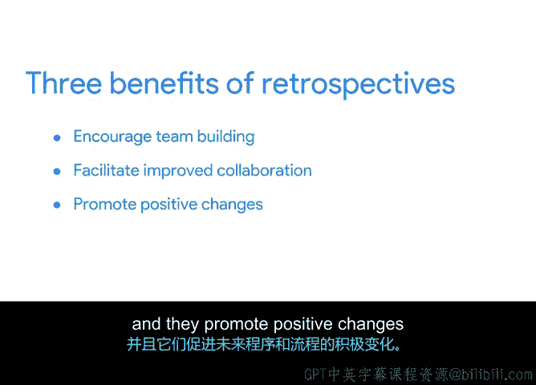

# 谷歌项目管理：专业证书 第4课：《项目执行：推动项目》｜project-execution-google｜ - P58：58_06_03_面向团队的收尾流程.zh_en - GPT中英字幕课程资源 - BV1Eu4y1i7Zk

Hi again。 In the last video， we focus on how to close out a project for your customer and stakeholders。

 In this video， we'll discuss the best practices for closing a project with your team。

 You'll also learn to use a retrospective to close your project and celebrate your team's accomplishments。

 I've talked to you about retrospectives quite a bit throughout this program。

 And that's because there really is no better tool for reflection and improvement。😊。

Retropecttives are such an important aspect of the project。

 and it's important to really emphasize that to you。Throughout the course。

 I'm referring to the formal practice， but a lot of us conduct informal retrospectives daily without even knowing it。

 Whether we're talking about our day with our friends or family or thinking about how we can improve past interactions。

 We are constantly reflecting and working toward progress。

 So let's revisit formal retrospectives for a moment to explore how they tie into the formal project closing process。

😊，You might remember that a retrospective is a meeting aim to discuss successes。

 failures and possible improvements on the project。

They can occur after a major milestone completion and at the end of a project。

In order to understand the importance of closing a project。

 let's discuss the three main retrospective benefits for your team。

 Retrospectives encourage team building because they allow team members to understand differing perspectives。

 Retrospectives facilitate improved collaboration on future projects。

And they promote positive changes in future procedures and processes。

So it's no surprise that a retrospective is a critical part of closing a project。

 whether your team has chosen to close the project after each phase or comprehensively at the end。

 you'll conduct retrospectives as a part of that process。

There may be temptation within your project team to resist reflecting before forging ahead into the next phase。

 but you can't grow and improve if you don't spend time reflecting。

Reflecting is a great way to learn which practices you should keep doing and which ones you can improve upon。

As a project manager， you want to build a culture within your team and company to aim for constant improvements。

This means that you'll need to solicit feedback that will help you to do better in your next project。

 This feedback might touch on any aspect of the project from planning， scheduling， execution。

 communication or team dynamics。You might receive feedback about processes you led。

 and that's okay working through feedback is crucial to your growth as a project manager。

It's important to create a safe space for that feedback so that folks can really share what their thinking and the team can grow together。

This is a key piece to help improve collaborations on future projects。

 Part of encouraging continuous growth is to recognize and celebrate a job well done。

 The way you celebrate will change depending on where you're at in the project and what feels most appropriate to your team。

😊，Taking a moment to reward yourselves with a token of appreciation turns the celebration into a team building exercise。

 Being appreciative ensures that the work you're doing feels uplifting and rewarding。

 rather than monotonous and tiring。😊，It also fuels positive change， so when closing a project。

 don't forget the fun elements， make sure to play a game， eat some cake。

 and celebrate some quality time together because you've earned it。

Let's review retrospectivetives encourage team building because they allow team members to understand differing perspectives。

 They facilitate improved collaboration on future projects。

 and they promote positive changes in future procedures and processes。

And now that you know how to wrap things up for your team。

 let's discuss how to wrap everything up for the project manager。

