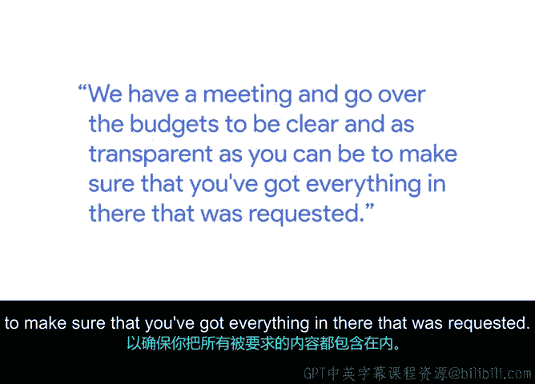

# 谷歌项目管理：专业证书 第4课：《项目执行：推动项目》｜project-execution-google｜ - P5：05_01_04_Belinda-预算跟踪与管理.zh_en - GPT中英字幕课程资源 - BV1Eu4y1i7Zk

Hi， my name is Belinda and I'm a program manager with Google My role with Google has been building budgets for the last several years there's a lot that goes into building data center budgets it can take quite some time and they're due every year for the renewal of the following year by September 1 the budget is entailed of anything you can think of down the janitorial services for the data center site all the way to UPS units to have to run as battery backup in case we lose power so the role that I have had for several years has been to not only build the budget but to figure out and work with the team and also vendors on what money is needed funding as we grow as a site as well and for me what I've always done is built a Google sheet and I've used that year over year line item by line item and I break it down for the account account code and also with the Dchan that references to that and basically that is just the categories of whether we're dealing with mechanical electrical chiller。

Maintenance for the lawn。rTU units， mechanical conops labor， repair and services to the elevators。

 lifts， golf carts， generators， you do a line by line item for anything that takes a data center to run。

So it can be very convoluted and quite difficult but I have always found that the Google sheet is the best method for my base structure of where I start currently there's four managers that I build that budget with we have a meeting and go over the budgets to be clear and as transparent as you can be to make sure that you've got everything in there that was requested what has happened over the years is what we'll have as we'll have a manager thatll be the lead with me on the budget so that when we go to submit the budget and we're at a director your level meeting when we're submitting this I have a FM manager from the site that is actually overseeing that budget it depends on who you're working with but they're going know what their needs are and they can help you understand when they need those needs and how much money they need so for anyone that's looking to go into project management budget management I think that they really need to know that they love math and they need it。

I love change because change happens so often with project management and dealing with budgets because they change hourly sometimes they change daily。

 sometimes you have a really really calm week where everything went like it was supposed to and then sometimes it's chaos you know for me I like being busy and I like change I'm not afraid of it but I think that people needed that would be interested in this type of role would need to understand that that's going to be there so anyone who's starting to build budgets with Google it can be quite overwhelming even though with the experience that I had it was overwhelming for me and I had to figure out a platform for me in this sheet that made sense so I could track it but I think that the advice I would give anyone that's starting out with budgets would be take it one day at a time you don't learn it all in one day it can be overwhelming but to break it down maybe in smaller pieces。

